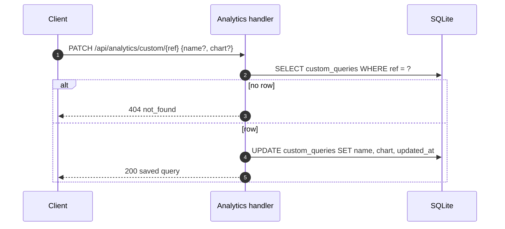

# PATCH /api/analytics/custom/{ref}

**Auth.** `Authorization: Bearer <credential>`: the instance password, or a token carrying `analytics:write`. Open mode passes everything through; with a password set, a missing or wrong credential is `401 unauthorized`, and a token without the scope is `403 forbidden`.

## Purpose

Rename a saved view or change its chart. The namespace is immutable: switching from
months to categories is a different question, so it is a new view.

## Upstream

"Rename view", the chart-type picker on a saved view.

## Downstream

`CustomQueryByRef`, then `UpdateCustomQuery`: one `UPDATE` of `name`, `chart`,
`updated_at`.

## Path / query params

| name | type | required | notes |
| --- | --- | --- | --- |
| `ref` | string | yes | the saved query's dashless UUID |

## Body

| field | type | required | notes |
| --- | --- | --- | --- |
| `name` | string | no | ≤ 80 characters, unique |
| `chart` | string | no | `bar`, `line`, `pie` |

## Response

**200** the saved query, same shape as `POST /api/analytics/custom`.

## Errors

`404 not_found` for an unknown ref; `422 invalid_request` for an unknown chart or a name
over the limit; `409 duplicate` when the new name is already taken by another view.

## Limitations

No delete and no namespace change; nothing tracks who edited a view last.

## Sequence

