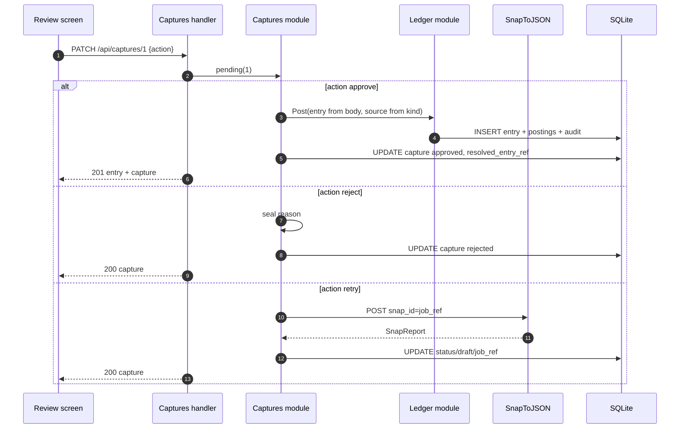

# PATCH /api/captures/{ref}

**Auth.** `Authorization: Bearer <credential>`: the root credential from `POST /api/session`, or a token carrying this route's scope. Open mode passes everything through; with a password set, a missing or stale credential is `401 unauthorized`, and a token without the scope is `403 forbidden`.

## Purpose

Resolve a queue item:

## Upstream

Review screen; the vendor reading a snap back.

## Downstream

`approve` → `Module.Ledger.Post` then `UpdateCapture` (a `kind='recurring'` capture also
resolves `recurring_rule_id` from its draft, so `(recurring_rule_id, occurred_on)` stays
unique and the journal records who tapped it);
`reject` → sealed reason + `UpdateCapture`; `retry` → `Repository.Snaptojson.Polling`
(a single-shot rail such as OpenAI answers `409 invalid_state`)
then map the report onto the row.

## Path / query params

`id` (int, required).

## Body

| `action` | other fields | result |
| --- | --- | --- |
| `approve` | `occurred_on`, `currency`, `postings[]`, optional `payee_id`, `note` | posts an entry, resolves the capture |
| `reject` | `reason` | `status":"rejected"`, `resolution_note` sealed |
| `retry` | — | reads `job_ref` back; `pending`, `extracting` or `failed` |

Posting shape is identical to `POST /api/entries`.

## Response

on approve: `{"entry":{…},"capture":{…}}`;

## Errors

`404 not_found`; `409 capture_resolved` (already approved/rejected);
`422 invalid_request` (`action` not `approve|reject|retry`, bad date/amount,
postings_not_balanced` and friends from the ledger; `401 unauthorized`…
`ErrNotConfigured`-style vendor gaps surface as `422`/`500` per `classify`.

## Limitations

`match` (link to an existing entry) and `extracted` (provider pushes a
draft) are not implemented. A capture whose vendor submit failed keeps
`extraction_error`; retry needs a `job_ref`, so a never-submitted capture answers
`409 invalid_state`.

---

## Sequence

