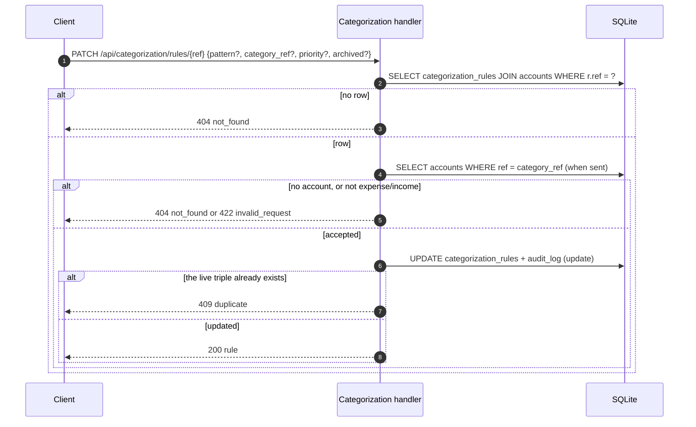

# PATCH /api/categorization/rules/{ref}

**Auth.** `Authorization: Bearer <credential>`: the instance password, or a token carrying the `categorization:write` scope. Open mode passes everything through; with a password set, a missing or wrong credential is `401 unauthorized`, and a token without the scope is `403 forbidden`.

## Purpose

Repoint a rule at another category, reorder it against its neighbours with a new priority, or
archive a rule that no longer describes the merchant.

## Upstream

The rules screen: dragging a rule up or down, fixing the category it names, archiving a rule
that aged badly.

## Downstream

`Repository.Sqlite.RuleByRef` (the rule joined to its category `ref`), then
`Repository.Sqlite.UpdateRule`: one `UPDATE` of `pattern`, `account_id`, `priority` and
`archived_at`, plus one `audit_log` row (`entity_kind = categorization_rule`, action
`update`) in the same transaction.

## Path / query params

| name | type | required | notes |
| --- | --- | --- | --- |
| `ref` | string | yes | the rule's 32 lowercase hex ref |

## Body

At least one field; the ones left out keep their stored value.

| field | type | required | notes |
| --- | --- | --- | --- |
| `pattern` | string | no | 2–80 characters after trimming; stored lowercased |
| `category_ref` | string | no | an `expense` or `income` account; replaces the current one |
| `priority` | int | no | higher wins inside a tier |
| `archived` | bool | no | `true` stamps `archived_at`, `false` clears it |

`field` and `match_kind` are not patchable: they are the identity of the rule, so a rule that
should look somewhere else is a new rule.

## Response

**200** the rule, same shape as `POST /api/categorization/rules`.

## Errors

`404 not_found` for an unknown rule ref or an unknown `category_ref`; `422 invalid_request`
when the new category is an `asset` or `liability` account, or the pattern is outside 2–80
characters; `409 duplicate` when the new pattern, field and match kind already belong to
another live rule.

## Limitations

Archive is the only removal — the row, its ref and its journal entries stay, and
`include_archived=true` still lists it. A rule archived and un-archived collides again with
any live rule that took its place, and that is a `409`, not a merge.

## Sequence

