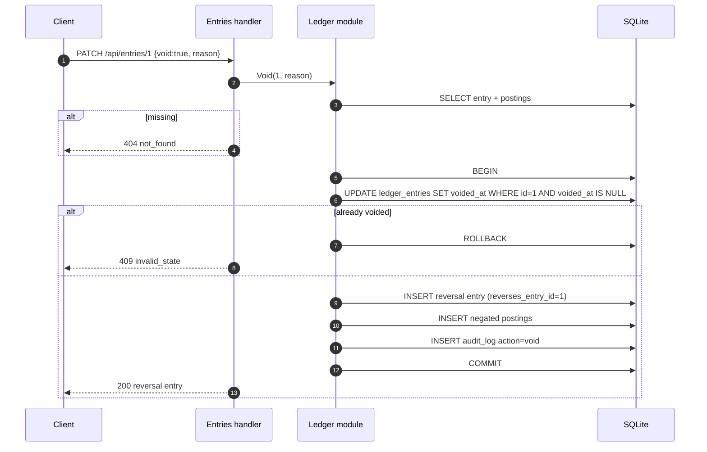

# PATCH /api/entries/{ref}

**Auth.** Session cookie (`spenicle_session`). Open mode passes everything through; with a password set, a missing or stale cookie is `401 unauthorized`.

## Purpose

Void an entry. The ledger never deletes: it writes the compensating entry
and stamps `voided_at` on the original, in one transaction.

## Upstream

Ledger screen ("I logged this twice").

## Downstream

`Module.Ledger.Void` → `Repository.Sqlite.VoidEntry`: read the original,
negate every posting, insert the reversal with `reverses_entry_id`, `UPDATE … voided_at
WHERE voided_at IS NULL`, insert `audit_log` action `void`.

## Path / query params

`id` (int, required).

## Body

| field | type | required | notes |
| --- | --- | --- | --- |
| `void` | bool | yes | must be `true` |
| `reason` | string | no | becomes the reversal's note |

## Response

the

## Errors

`404 not_found`; `409 invalid_state` (already voided); `422
unsupported_patch` for any other field edit; `422 invalid_request` when `{ref}` is not a
positive integer; `400 invalid_json`.

## Limitations

Field edits (note, payee) are not implemented — they answer 422
rather than pretending. `voided_at` is not serialised in listings yet; the reversal row
is the evidence.

---

## Sequence

