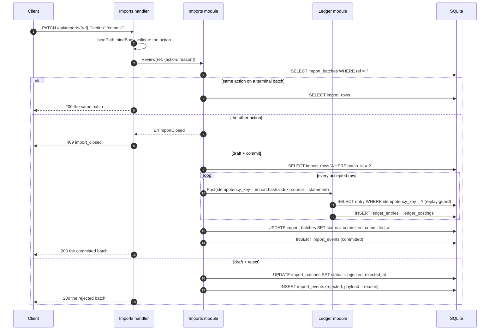

# PATCH /api/imports/{ref}

**Auth.** `Authorization: Bearer <credential>`: the instance password, or a token carrying `imports:write`. `commit` also needs `entries:write`, because it posts ledger entries; `reject` needs only `imports:write`. Open mode passes everything through; with a password set, a missing or wrong credential is `401 unauthorized`, and a missing action scope is `403 forbidden` before the batch is loaded.

## Purpose

Close a draft, with one action in the body:

- `commit` posts every row the user accepted to the ledger and turns the batch `committed`;
- `reject` throws the draft away, turns the batch `rejected` and keeps the rows and the file for audit.

The same action twice on a terminal batch is a no-op (`200` with the current batch, no second posting, no second event); the other action on a closed batch is `409 import_closed`.

## Upstream

The review screen's "commit" and "discard" buttons; a script that retries after a timeout, which is exactly why both actions are replayable.

## Downstream

`Module.Imports.Review`: load the batch (`404` when the ref names none), then one of two paths.

`commit`:

- a `committed` batch returns as-is, a `rejected` one is `409 import_closed`;
- the batch is flipped `draft → committing` with a compare-and-swap
  (`UPDATE … WHERE status = 'draft'`); the loser of that race re-reads and either
  resumes or answers `409`;
- accepted rows are posted in chunks of `ImportCommitChunk` (default 500). After
  each chunk one `committing` event carries `{"rows_done":N,"rows_total":M}`, and
  `ctx.Err()` is checked between chunks, so a cancelled request stops between two
  chunks with the batch still `committing`;
- for each row with `status = accepted`, `ledger.Post` with
  - `idempotency_key = import:<file_hash>:<row_index>`,
  - `source = statement`, `occurred_on` from the row, note = the description, payee when one was patched,
  - currency = the batch currency (the locked base currency),
  - postings `[{account_ref, -amount_minor}, {category_ref or Unsorted, +amount_minor}]`;
- `Repository.Sqlite.CloseImportBatch` stamps `status = committed` and `committed_at`, and one `committed` event is appended.

A replay of `commit` on a batch left `committing` by a cancelled request or a
restart **resumes**: the rows whose
`idempotency_key = import:<file_hash>:<row_index>` is already in the ledger are skipped
(that probe is the resume filter) and only the rest are posted. The ledger
`idempotency_key` is the final guard, so no row can be posted twice.

`reject`:

- a `rejected` batch returns as-is, a `committed` one is `409 import_closed`;
- `CloseImportBatch` stamps `status = rejected` and `rejected_at` — the rows and the blob are untouched;
- one `rejected` event is appended, carrying `{"reason": "..."}` when the body sent one. The reason lives on the event, never on the batch row.

## Path / query params

`{ref}` is the batch ref (32 lowercase hex).

## Body

| field | type | notes |
| --- | --- | --- |
| `action` | string | required, `commit` or `reject` |
| `reason` | string | optional, at most 1000 characters; stored on the `rejected` event and ignored by `commit` |

## Response

`200` with the batch document (rows included). `status` is `committed` with `committed_at` set, or `rejected` with `rejected_at` set. A replay answers the identical document: the second call finds the terminal status and stops before the ledger and before the event log.

Rows that were `pending` or `skipped` are not posted and stay in the batch for audit — a `skipped` row is how the shell keeps the reason it did not post something.

## Errors

- `403 forbidden` — a `commit` without `entries:write`; the check runs before the batch is loaded.
- `409 import_closed` — the other action on a terminal batch: `commit` on a `rejected` batch, `reject` on a `committed` one. The message names the state; the entries of a committed batch are undone with `PATCH /api/entries/{ref}` and `{"void": true}`, not here.
- `404 not_found` — the ref names no batch.
- `422 invalid_request` — `action` missing or not one of the two, `reason` too long.
- `422 invalid_postings`, `422 unknown_currency`, `422 invalid_rate` — a row could not become a balanced entry (a deleted account, a category that is not an account); nothing after it is posted and the batch stays `committing`, so the fix is a `PATCH` on the row and a commit replay, which resumes.

## Limitations

Not one transaction: the ledger writes are per-row entries, so a failure halfway leaves the rows already posted behind. That is deliberate — each row is its own `idempotency_key`, so retrying the commit resumes instead of duplicating. A partial failure does not put the batch back to `draft`: it stays `committing` (only a full success or a `reject` closes it), and a replay resumes from the rows whose ledger `idempotency_key` is still missing — never a half-posted draft. No partial-failure report in the response yet.

A rejected batch cannot be reopened: upload the file again under a new `idempotency_key` (a fresh draft recomputes the clashes). A committed or rejected batch is kept forever — rows, blob and events — while an abandoned `draft` is reclaimed by the worker 24 hours after its last edit.

## Sequence

