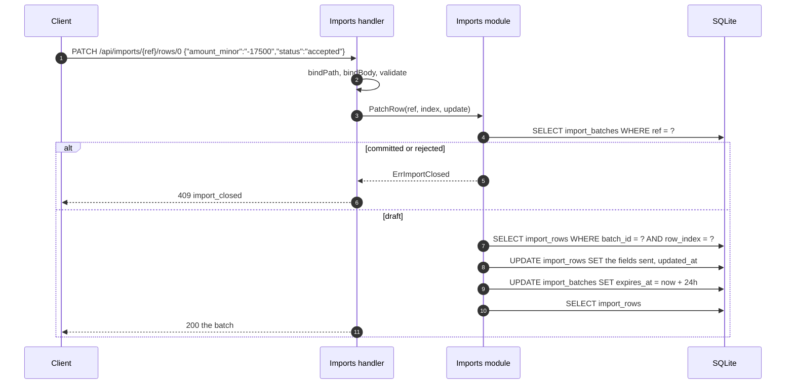

# PATCH /api/imports/{ref}/rows/{index}

**Auth.** `Authorization: Bearer <credential>`: the root credential from `POST /api/session`, or a token carrying this route's scope. Open mode passes everything through; with a password set, a missing or stale credential is `401 unauthorized`, and a token without the scope is `403 forbidden`.

## Purpose

Edit one drafted row before the commit: fix the date or the amount, name the category or the payee, or decide that a row with a clash (or without one) should be posted or not. Every field is **absolute**, so re-sending the same body is a no-op — the retry-after-a-network-drop path.

## Upstream

The review screen's row editor; a script that accepts every row it recognises.

## Downstream

`Module.Imports.PatchRow`: load the batch, refuse a closed one (`409 import_closed`), load the row by `(batch_id, row_index)`, apply the fields that are present, then `Repository.Sqlite.UpdateImportRow`. The row's `edited_at` is stamped on the first edit and `edited_fields` accumulates the union of the fields touched so far. `ExtendImportBatch` pushes `expires_at` another 24 hours. One `row_edited` event records the field list in request order, and a status change adds a `row_accepted` or `row_skipped` event. The response is the whole batch, so the client never merges two documents.

## Path / query params

| name | notes |
| --- | --- |
| `ref` | the batch ref (32 lowercase hex) |
| `index` | the row's `row_index`, the 0-based position in the file |

## Body

| field | type | notes |
| --- | --- | --- |
| `occurred_on` | string | `YYYY-MM-DD` |
| `amount_minor` | string | signed minor units, `"-17500"` |
| `description` | string | at most 500 characters |
| `payee_ref` | string | a payee ref, `""` clears it |
| `category_ref` | string | an account ref, `""` clears it (the commit then uses `Unsorted`) |
| `status` | string | `accepted` or `skipped`; `pending` is server-assigned and not settable |

At least one field must be present. The `account_ref` of a row is fixed at upload: it is the batch's account.

## Response

`200` with the batch document from [`POST /api/imports`](./POST_api_imports.md), rows included, and `expires_at` moved forward.

## Errors

- `409 import_closed` — the batch is `committed` or `rejected` and the message names which; a closed batch is immutable.
- `404 not_found` — the batch ref or the row index does not exist.
- `422 invalid_request` — no field was sent, `status` is not `accepted`/`skipped`, `occurred_on` or `amount_minor` does not parse, a `_ref` is not 32 hex, or the description is too long.

## Limitations

The row's account and its clash verdict are not editable: a clash is a warning about the ledger as it was at upload time, and a change of account is a new upload. No bulk patch — one row per request keeps the retry story trivial.

## Sequence

