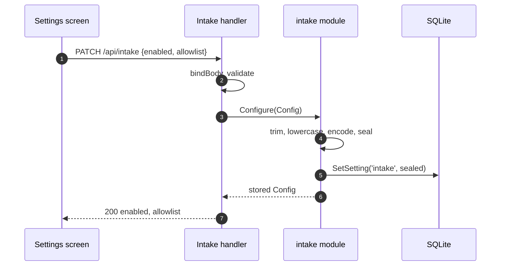

# PATCH /api/intake

**Auth.** `Authorization: Bearer <credential>`: the instance password, or a token carrying this route's scope. Open mode passes everything through; with a password set, a missing or wrong credential is `401 unauthorized`, and a token without the scope is `403 forbidden`. This route lives in the root-only group, so only the instance password reaches it.

## Purpose

Turn polling on or off and set the sender allowlist. One action, both fields, sealed at rest.

## Upstream

The settings screen after the mailbox is authorised.

## Downstream

`Module.Intake.Configure` → `Repository.Sqlite.SetSetting` with a sealed JSON envelope under
the `intake` key. Last write wins; there is one configuration, not one per sender.

## Path / query params

None.

## Body

| field | type | notes |
| --- | --- | --- |
| `enabled` | bool | required, so the caller always states the intent |
| `allowlist` | string list | ≤ 50 entries, each ≤ 200 characters; matched against the lowercased `From` |

An entry is a **substring** of the sender, so `bank.example` accepts
`alerts@bank.example`. Values are trimmed and lowercased before they are stored.

## Response

**200** `{"enabled":true,"allowlist":["bank.example"]}` — the stored configuration, not the
request echoed back.

## Errors

- `422 invalid_request` — the body does not bind, or a list entry is too long.
- `500 internal_error` — the row could not be sealed or written.

## Limitations

- The allowlist is not a blocklist: an empty list accepts everything, which is only safe once
  the mailbox itself belongs to you.
- Substring matching means `example` accepts `example.com` and `evil-example.net`. Keep
  entries specific.

## Sequence

