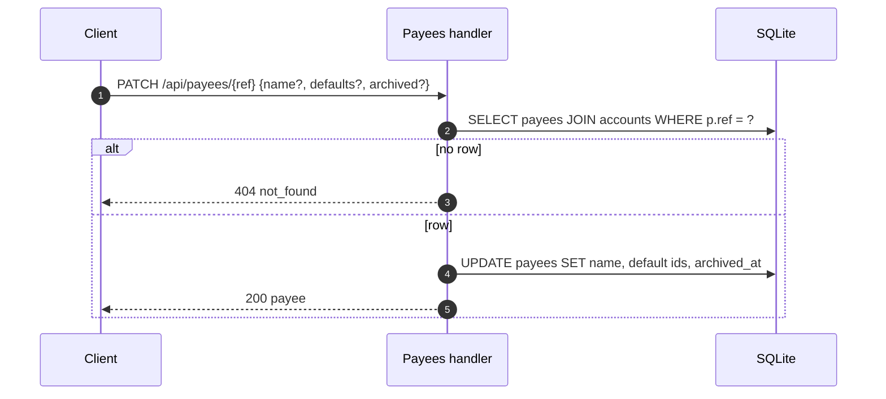

# PATCH /api/payees/{ref}

**Auth.** `Authorization: Bearer <credential>`: the instance password, or a token carrying this route's scope. Open mode passes everything through; with a password set, a missing or wrong credential is `401 unauthorized`, and a token without the scope is `403 forbidden`.

## Purpose

Rename a payee, point its defaults at different accounts, or archive it.

## Upstream

The payee edit sheet, "archive this payee" after a one-off merchant.

## Downstream

`PayeeByRef` (a join that turns the stored ids back into refs), then `UpdatePayee`:
one `UPDATE` of `name`, both default ids and `archived_at`.

## Path / query params

| name | type | required | notes |
| --- | --- | --- | --- |
| `ref` | string | yes | the payee's dashless UUID |

## Body

| field | type | required | notes |
| --- | --- | --- | --- |
| `name` | string | no | ≤ 80 characters |
| `default_account_ref` | string | no | replaces the current default |
| `default_category_ref` | string | no | replaces the current category |
| `archived` | bool | no | `true` stamps `archived_at`, `false` clears it |

## Response

**200** the payee, same shape as `POST /api/payees`.

## Errors

`404 not_found` for an unknown payee; `422 unknown_reference` when a new default points
at an account nobody owns; `422 invalid_request` for a name over the limit.

## Limitations

No merge, no delete (archive instead), and no "rename everywhere" — historical entries
keep the payee id they were posted with.

## Sequence

