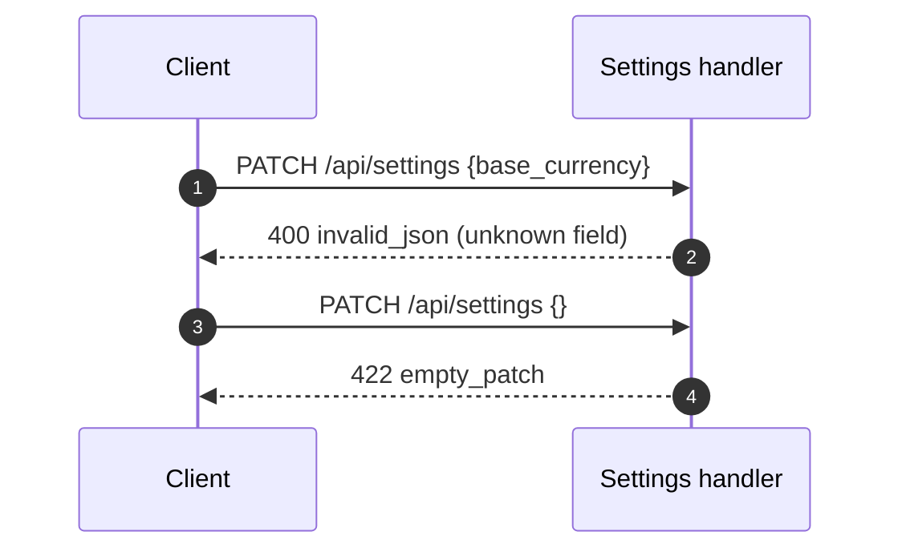

# PATCH /api/settings

**Auth.** **The instance password only**: `Authorization: Bearer <password>`. A token answers `403 forbidden`.

## Purpose

Reserved for the settings fields that will become editable. Today there are none: the
base currency is chosen once by [`POST /api/setup`](./POST_api_setup.md) and the
timezone is pinned at boot, so every body this route receives is refused.

## Upstream

Settings screen. A client should call `POST /api/setup` to choose the base currency.

## Downstream

None: the body is decoded, then refused. No module call, no write.

## Path / query params

None.

## Body

| field | type | required | notes |
| --- | --- | --- | --- |
| — | — | — | no field is accepted |

`base_currency` is **not** part of this request. The decoder refuses unknown fields, so
sending `{"base_currency":"USD"}` answers `400 invalid_json` — the currency can only be
chosen through `POST /api/setup`, whose completion marker locks it even when the ledger
is empty. `timezone` is refused the same way; it comes from `APP_TIMEZONE` and no request
can change it.

## Response

None: there is no accepted body today.

## Errors

`400 invalid_json` for any field, including `base_currency` and `timezone`;
`422 empty_patch` for `{}`.

## Limitations

The route exists so a client can discover that nothing is patchable instead of getting a
`404`. When a settings field does become editable it is added here, one field at a time,
each with its own lock rule.

---

## Sequence

