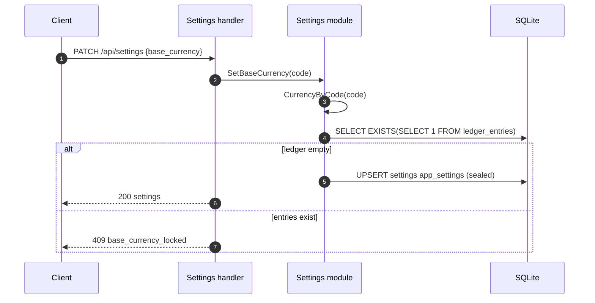

# PATCH /api/settings

**Auth.** Session cookie (`spenicle_session`). Open mode passes everything through; with a password set, a missing or stale cookie is `401 unauthorized`.

## Purpose

Choose the reporting currency. Allowed only while the ledger is empty:
after the first entry the numbers would stop meaning the same thing.

## Upstream

Setup wizard / settings screen before the first entry.

## Downstream

`Module.Settings.SetBaseCurrency` → `Repository.Sqlite.HasEntries`
(`SELECT EXISTS(… ledger_entries)`), then re-seal the settings row.

## Path / query params

None.

## Body

| field | type | required | notes |
| --- | --- | --- | --- |
| `base_currency` | string | yes (today) | ISO 4217, case-insensitive |

## Response

`{"base_currency":"USD", …}`

## Errors

`409 base_currency_locked` once any entry exists; `422 unknown_currency`;
`422 empty_patch` when the body has nothing to change; `400 invalid_json`.

## Limitations

Only `base_currency` is patchable so far; no reset of the entry lock —
voiding entries does not unlock it, by design (the decision was made). `timezone`
is not patchable at all: it is set once at the first boot from `APP_TIMEZONE`
(default `UTC`) and stored in the sealed row. Sending `timezone` in the body is
ignored, and a boot whose `APP_TIMEZONE` differs from the stored value fails
(`config: timezone is set once: stored "UTC", env "Asia/Jakarta"`).

---

## Sequence

