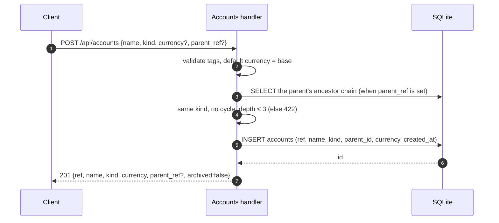

# POST /api/accounts

**Auth.** `Authorization: Bearer <credential>`: the instance password, or a token carrying this route's scope. Open mode passes everything through; with a password set, a missing or wrong credential is `401 unauthorized`, and a token without the scope is `403 forbidden`.

## Purpose

Create an account or a category. A category is not a table: it is an account whose
`kind` is `expense` or `income`, so the whole chart of accounts is one collection and
every posting target has one shape.

## Upstream

The setup wizard, the "add account" sheet, an agent seeding defaults.

## Downstream

`Repository.Sqlite.CreateAccountWithParent`: one `accounts` row with a fresh UUIDv7
`ref`, then the handler answers. When `parent_ref` is sent, the store walks the parent's
ancestor chain in the same transaction and refuses a parent of another `kind`, a chain
deeper than three levels, and a cycle. No ledger entry is written here — an account with
0 balance is a normal state; only an opening balance (a future `POST /api/setup`) posts.

## Path / query params

None.

## Body

| field | type | required | notes |
| --- | --- | --- | --- |
| `name` | string | yes | ≤ 80 characters; unique per `kind` |
| `kind` | string | yes | `asset`, `liability`, `expense`, `income` |
| `currency` | string | no | ISO 4217; defaults to the base currency |
| `parent_ref` | ref | no | an existing account of the same `kind`; the new account becomes its child |

## Response

**201** `{"ref":"…","name":"Groceries","kind":"expense","currency":"IDR","parent_ref":"…","archived":false}`

`ref` is the only identifier the client keeps: every request that mentions an account
sends this value. `parent_ref` is omitted when the account sits at the top of the tree.

## Errors

`422 invalid_request` when `name` is missing, `kind` is not one of the four, the parent
carries another `kind`, the new account would land below the third level, or the parent
would close a cycle; `422 unknown_currency` for a code this build does not know;
`422 unknown_reference` when `parent_ref` names no account.

## Limitations

No icon or opening balance in this route yet — use `PATCH /api/accounts/{ref}` to rename,
add an icon or archive. Three levels is the ceiling (`child → parent → grandparent`). A
duplicate `name`+`kind` pair is refused by the unique index (a `500` today, not a
friendly `409`).

## Sequence

