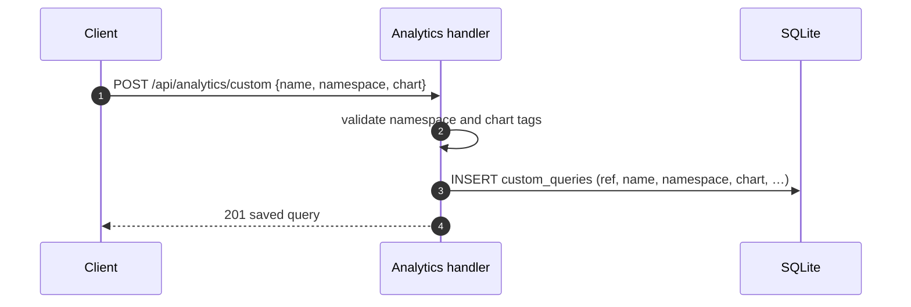

# POST /api/analytics/custom

**Auth.** `Authorization: Bearer <credential>`: the root credential from `POST /api/session`, or a token carrying this route's scope. Open mode passes everything through; with a password set, a missing or stale credential is `401 unauthorized`, and a token without the scope is `403 forbidden`.

## Purpose

Save a named analytics view — the Grafana idea, without the dashboard engine: a
namespace plus the chart you want for it. Running it is a separate GET, so the browser
can bookmark a view and render the same shape every time.

## Upstream

"Save this chart", a template list, an agent pinning a monthly review.

## Downstream

`Repository.Sqlite.CreateCustomQuery`: one `custom_queries` row with a fresh `ref`.

## Path / query params

None.

## Body

| field | type | required | notes |
| --- | --- | --- | --- |
| `name` | string | yes | ≤ 80 characters, unique |
| `namespace` | string | yes | `months` or `categories` |
| `chart` | string | yes | `bar`, `line` or `pie` |

## Response

**201** `{"ref":"…","name":"Spend per month","namespace":"months","chart":"bar","created_at":"…"}`

## Errors

`422 invalid_request` for an unknown namespace or chart, or a missing name.

## Limitations

The saved view stores *what* to ask, not the SQL: namespaces are fixed, so a new
grouping means a new namespace in the code. A duplicate name is refused by the unique
index (`500`, not `409`).

## Sequence

