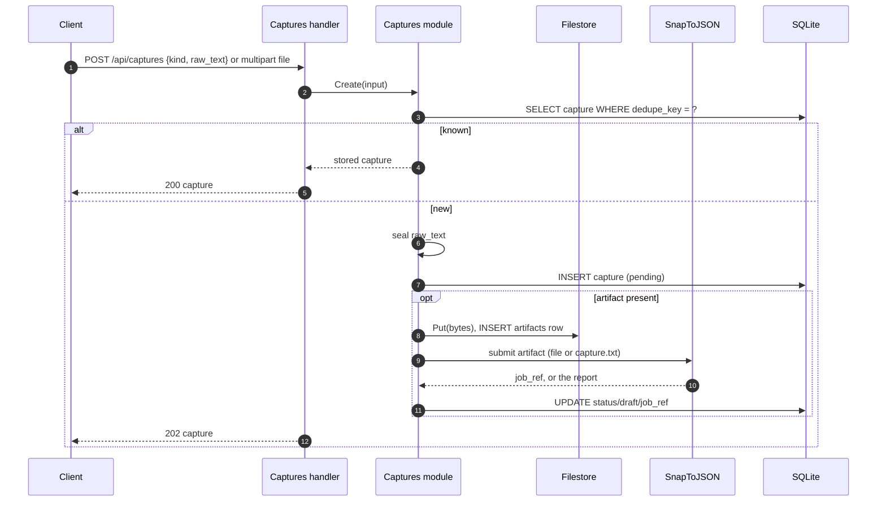

# POST /api/captures

**Auth.** `Authorization: Bearer <credential>`: the instance password, or a token carrying this route's scope. Open mode passes everything through; with a password set, a missing or wrong credential is `401 unauthorized`, and a token without the scope is `403 forbidden`.

## Purpose

Park something unconfirmed. Nothing reaches the ledger until it is approved. Accepts JSON
text or a multipart upload.

## Upstream

PWA share target, Shortcut, an agent dumping a receipt, the mailbox poller.

## Downstream

`Module.Captures.Create`: dedupe key `sha256(kind|idempotency_key|artifact_hash|raw_text)`, seal
the payload, insert the row, then — when `SNAPTOJSON_API_KEY` is set — submit the artifact
to the rail: the uploaded file when there is one, else the pasted text as a `capture.txt`.
The answer is stored with the `extraction_rail` that read it and the `extraction_model` it
ran on. SnapToJSON is the only rail; OpenAI is not a fallback, so an instance without the
key keeps every capture manual.

## Path / query params

None.

## Body

| field | type | required | notes |
| --- | --- | --- | --- |
| `idempotency_key` | string | no | ≤ 64, part of the dedupe key |
| `kind` | string | yes | `share`, `image`, `email`, `statement`, `recurring`, `manual` |
| `raw_text` | string | no | ≤ 8000, sealed before storage |
| `batch_label` | string | no | groups a statement upload |
| `file` | multipart part | no | one file, up to `APP_ARTIFACT_MAX_BYTES` (10 MiB by default) |

## Response

`202` when the row is new — `status` `pending`, or `extracting` with a `job_ref` when the
rail accepted the submit — and `200` on a dedupe replay of the same bytes.

## Errors

`422 unknown_capture_kind`; `400 invalid_request` (a body that does not parse — this
route decodes with a plain decoder, so an unknown field is ignored rather than refused —
or a multipart body without a `file` part, which is refused before validation runs);
`422 invalid_request` for a `raw_text` over its limit.
Vendor failures are recorded on its payload row as `extraction_error`, not raised.

## Limitations

No PDF parsing (the vendor reads images and email text); the completeness gate is not
implemented. One artifact per capture, and retry needs a `job_ref`, so a capture that was
never submitted answers `409 invalid_state`.

---

## Sequence

