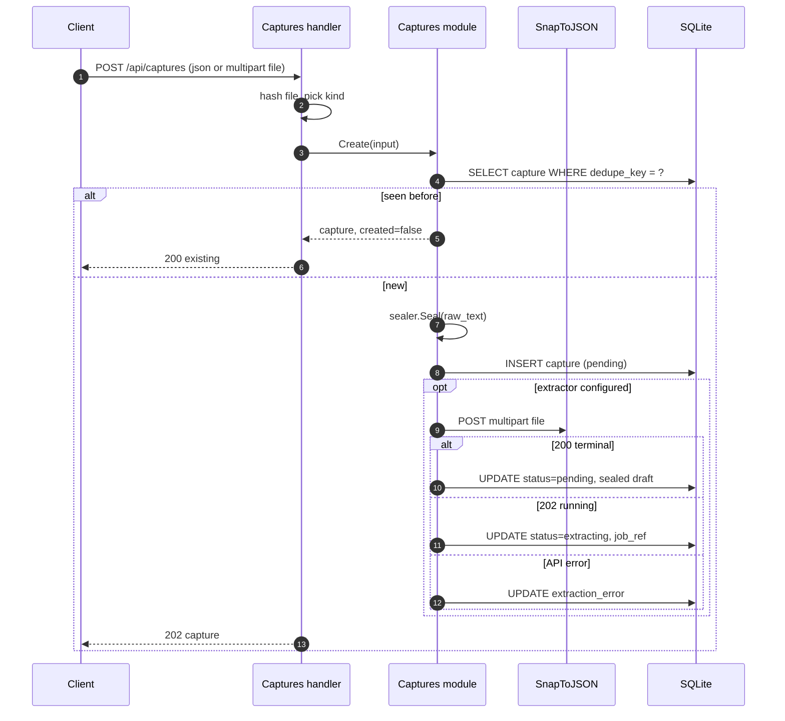

# POST /api/captures

**Auth.** `Authorization: Bearer <credential>`: the root credential from `POST /api/session`, or a token carrying this route's scope. Open mode passes everything through; with a password set, a missing or stale credential is `401 unauthorized`, and a token without the scope is `403 forbidden`.

## Purpose

Park something unconfirmed. Nothing reaches the ledger until it is
approved. Accepts JSON text or a multipart upload.

## Upstream

PWA share target, Shortcut, agent dumping a receipt, email poller (later).

## Downstream

`Module.Captures.Create`: dedupe key `sha256(kind|client_id|artifact_hash|raw_text)`,
seal the payload, insert the row, then — when `SNAPTOJSON_API_KEY` is set — submit the
file to the configured rail (`Repository.Snaptojson.Posting` or
`Repository.OpenAI.Posting`) and store the answer, tagged with the `extraction_rail` that
read it and the `extraction_model` it ran on.

## Path / query params

None.

## Body

| field | type | required | notes |
| --- | --- | --- | --- |
| `client_id` | string | no | part of the dedupe key |
| `kind` | string | yes | `share`, `image`, `email`, `statement`, `recurring`, `manual` |
| `raw_text` | string | no | sealed before storage |
| `batch_id` | string | no | groups a statement import |

## Response

created (`status` `pending`, or `extracting` when a submit answered 202),

## Errors

`422 unknown_capture_kind`; `400 invalid_json` (malformed body); `422
invalid_request` (multipart body without a `file` part); `413`-class failures from the
vendor are recorded on the row, not raised.

## Limitations

No PDF/statements support yet (the vendor reads images today); no
`raw/` artifact storage, so a 202 is polled by `job_ref` and the bytes are gone; the
completeness gate is not implemented.

---

## Sequence

