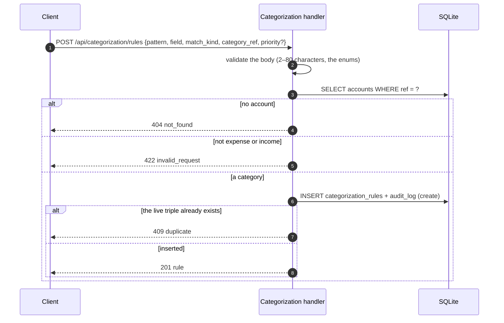

# POST /api/categorization/rules

**Auth.** `Authorization: Bearer <credential>`: the instance password, or a token carrying the `categorization:write` scope. Open mode passes everything through; with a password set, a missing or wrong credential is `401 unauthorized`, and a token without the scope is `403 forbidden`.

## Purpose

Teach the instance one deterministic rule: "a payee name that contains `indomaret` is a
grocery". No machine learning, no regex — a pattern, a field to look in and a match kind,
which is what makes the suggestion repeatable and reviewable.

## Upstream

The rules screen, or an agent turning a recurring merchant into a rule after the third time
it landed in the wrong category.

## Downstream

`Repository.Sqlite.CreateRule`: resolves the category `ref` to its internal id, inserts the
row with the pattern trimmed and lowercased, and appends one `audit_log` row
(`entity_kind = categorization_rule`, action `create`) inside the same transaction.

## Path / query params

None.

## Body

| field | type | required | notes |
| --- | --- | --- | --- |
| `pattern` | string | yes | 2–80 characters after trimming; stored lowercased |
| `field` | string | yes | `payee` or `note` |
| `match_kind` | string | yes | `exact`, `contains` or `prefix` |
| `category_ref` | string | yes | an `expense` or `income` account |
| `priority` | int | no | 0 by default; higher wins inside a tier |

Two live rules cannot share `(pattern, field, match_kind)`: a partial unique index enforces
it, so `INDOMARET` and `indomaret` collide.

## Response

**201** `{"ref":"<32 hex>","pattern":"indomaret","field":"payee","match_kind":"contains","category_ref":"<32 hex>","priority":0,"archived":false,"created_at":"<iso 8601>"}`

## Errors

`404 not_found` when `category_ref` names no account; `422 invalid_request` when the category
is an `asset` or `liability` account, when the pattern is outside 2–80 characters, when
`field`/`match_kind` is not a known pair, or when `field: "note"` asks for
`match_kind: "exact"` (a note is prose — use `contains` or `prefix`); `409 duplicate` when a
live rule already covers the same pattern, field and match kind.

## Limitations

No regex and no fuzzy match — `contains` is a substring test on the case-folded text.
A rule is a suggestion, never a posting: approving a capture is still what writes the entry.

## Sequence

