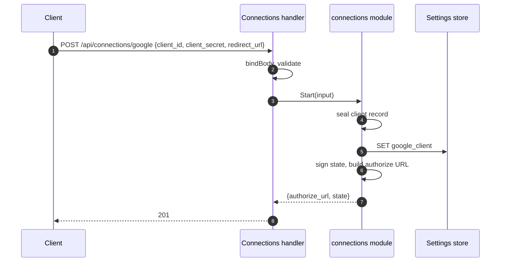

# POST /api/connections/google

**Auth.** Instance password only. This route lives in the root-only group: a scoped Bearer credential is refused with `403 forbidden` before the handler runs; with no password seeded, open mode passes the request through.

## Purpose

Store Google OAuth client credentials and return the URL the user follows to grant mailbox access.

## Upstream

The settings screen's "connect Google" form.

## Downstream

`Module.Connections.Start` seals the client record under the `google_client` setting,
signs a timestamped state with `sealer.Digest`, and asks the Gmail authorizer for the
authorize URL.

## Path / query params

None.

## Body

| field | type | required | notes |
| --- | --- | --- | --- |
| `client_id` | string | yes | 8–200 characters after trimming |
| `client_secret` | string | yes | 8–200 characters after trimming |
| `redirect_url` | string | yes | URL, ≤ 500 characters; trimmed and stored as sent — nothing verifies that it is the callback, so point it at `GET /api/connections/google/callback` |

## Response

**201**

```json
{"authorize_url":"https://accounts.google.com/o/oauth2/v2/auth?...","state":"1770000000.<digest>"}
```

The caller stores `state` and supplies it unchanged to the callback; the credentials are never echoed.

## Errors

- `422 invalid_request` — a missing or short client id/secret, or an invalid redirect URL.
- `500 internal_error` — sealing or storing the client record failed.

## Limitations

Google is the only authorizer wired; there is no IMAP option and no provider list. The state is a timestamp plus a sealed digest, valid for 10 minutes, and is not stored as a row. Each call replaces the stored client record; only one Google connection is tracked.

## Sequence


