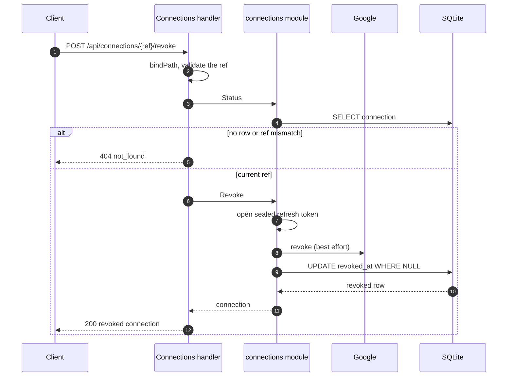

# POST /api/connections/{ref}/revoke

**Auth.** Instance password only. This route lives in the root-only group: a scoped Bearer credential is refused with `403 forbidden` before the handler runs; with no password seeded, open mode passes the request through.

## Purpose

Disconnect the stored mailbox grant. The row stays with a `revoked_at` stamp; the credential stops being usable for intake.

## Upstream

The settings screen's "revoke" action, next to the connection shown by `GET /api/connections`.

## Downstream

`Module.Connections.Revoke`: open the sealed refresh token, make a best-effort provider revoke call, then `Repository.Sqlite.RevokeConnection` stamps `revoked_at` where it is still null.

## Path / query params

| param | notes |
| --- | --- |
| `ref` | the connection's 32-hex ref; it must match the current connection |

## Body

None.

## Response

**200** with the revoked connection: `ref`, `provider`, `status`, `account`, `scopes` and `revoked_at` when present.

## Errors

- `403 forbidden` — the caller is a scoped token.
- `404 not_found` — no connection exists, the ref does not match, or it was already revoked.
- `422 invalid_request` — the ref is not 32 hex.
- `500 internal_error` — opening the token or stamping the revocation failed.

## Limitations

Provider revocation is best-effort: its error is ignored so the local revocation always lands. There is no delete and no un-revoke: reconnect with `POST /api/connections/google`. After revocation `GET /api/connections` still returns the row, with `revoked_at`, and intake reports `reauth_required` instead of using the stale grant.

## Sequence

