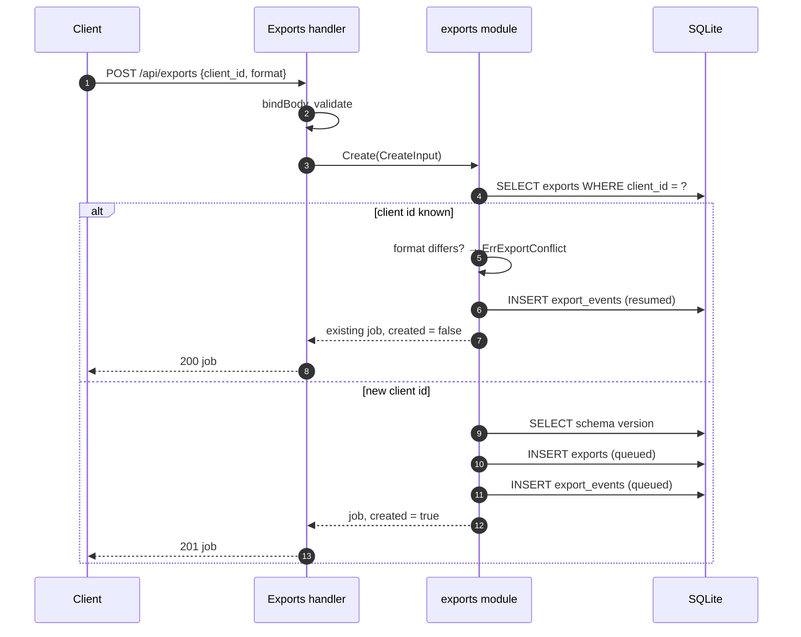

# POST /api/exports

**Auth.** Session cookie (`spenicle_session`). Open mode passes everything through; with a password set, a missing or stale cookie is `401 unauthorized`.

## Purpose

Queue one export of the whole ledger. The route answers `201` with a `queued` job and returns immediately: the worker renders the document later, so a slow read costs a job, not a request. `client_id` is the idempotency key — a replay returns the same job instead of a second one.

## Upstream

The "export" button, a script before an upgrade, or the spreadsheet path. One call per direction: this one never returns bytes, `GET /api/exports/{ref}/download` does.

## Downstream

`Module.Exports.Create`: look up `exports.client_id`, read `SchemaVersion` from `System`, insert the `queued` row and append the `queued` event in the same call. Nothing is rendered and nothing is read from the ledger.

## Path / query params

None.

## Body

```json
{"client_id": "laptop-2026-02-14", "format": "json"}
```

| field | type | required | notes |
| --- | --- | --- | --- |
| `client_id` | string | yes | ≤ 64, the idempotency key |
| `format` | string | no | `json` (default) or `csv` |

## Response

`201` for a new job, `200` for a replay of the same `client_id` and `format`:

```json
{
  "ref": "3f2a…",
  "client_id": "laptop-2026-02-14",
  "status": "queued",
  "format": "json",
  "schema_version": 1,
  "bytes": 0,
  "created_at": "2026-02-14T09:00:00Z"
}
```

`counts` (per table), `started_at`, `finished_at`, `expires_at` and `error_message` appear once the worker has claimed or finished the job.

## Errors

- `409 export_conflict` — the same `client_id` already names a job with another `format`. The existing job is untouched and one `resumed` event is not written.
- `422 invalid_request` — `client_id` missing or too long, `format` neither `json` nor `csv`.
- `400 invalid_json` — the body is not JSON or carries an unknown field.
- `500 internal_error` — the write failed; the cause is logged, never sent.

## Limitations

- One export at a time per `client_id`; there is no "cancel" and no re-queue. A `failed` job keeps its `error_message`, and the way forward is another `client_id`.
- The job is `queued` until the next worker tick claims it (`WorkerInterval`, one hour by default). The document is not a snapshot of the request: it is rendered when claimed, so it carries whatever the ledger holds at that moment.
- `format` is fixed at creation. Changing your mind is a new job.

## Sequence


