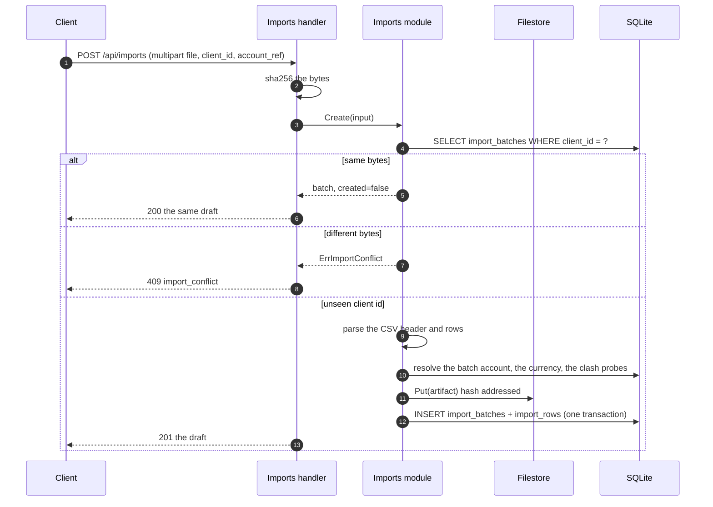

# POST /api/imports

**Auth.** `Authorization: Bearer <credential>`: the root credential from `POST /api/session`, or a token carrying this route's scope. Open mode passes everything through; with a password set, a missing or stale credential is `401 unauthorized`, and a token without the scope is `403 forbidden`.

## Purpose

Turn one uploaded CSV statement into a durable **draft**: rows the user reviews and edits one by one, then one review action on [`PATCH /api/imports/{ref}`](./PATCH_api_imports_ref.md) — `commit` posts the accepted ones, `reject` discards the draft. Nothing reaches the ledger here.

The upload is also the first row of the batch's event log (`uploaded`, or `resumed` when the same `client_id` and bytes come back); the whole trail is read at [`GET /api/imports/{ref}/events`](./GET_api_imports_ref_events.md).

The statement contract is fixed and small:

| column | meaning |
| --- | --- |
| `occurred_on` | `YYYY-MM-DD` |
| `amount_minor` | signed integer of minor units, negative = money out |
| `description` | free text, at most 500 characters |

The header row is required and must read exactly `occurred_on,amount_minor,description`. Anything else is `422 invalid_request` and no batch is written. A well-formed header with a bad row does **not** fail the upload: the row is stored with `status: "skipped"` and `clash_kind: "invalid_row"`.

## Upstream

The web shell's "upload a statement" action, a script, or an agent dragging a bank export. The caller picks a `client_id` it can replay after a restart.

## Downstream

`Module.Imports.Create` hashes the bytes (sha256), stores them with `Repository.Filestore.Put` (hash addressed, no `artifacts` row — the batch keeps `file_hash`), parses the CSV, resolves the batch account and the batch currency, runs the clash probes once per row, then writes `import_batches` plus every `import_rows` in one transaction.

Clash detection, deterministic and computed at upload:

| `clash_kind` | rule | default status |
| --- | --- | --- |
| `already_imported` | a ledger entry already exists with `client_id = import:<file_hash>:<row_index>` | `skipped` |
| `duplicate` | an entry with the same `occurred_on`, same currency, same absolute `amount_minor` and a posting on the batch account | `skipped` |
| `possible_duplicate` | the amount and currency match and the date is within 3 days | `skipped` |
| `invalid_row` | the row does not parse | `skipped` |
| *(none)* | | `pending` |

A skipped row is a suggestion, not a veto: `PATCH /api/imports/{ref}/rows/{index}` can set it to `accepted` and the next commit posts it.

## Path / query params

None.

## Body

`multipart/form-data`:

| field | required | notes |
| --- | --- | --- |
| `file` | yes | the CSV bytes, at most `ImportMaxBytes` (default 32 MiB) |
| `client_id` | yes | ≤ 64 characters, the idempotency key |
| `account_ref` | no | the account the rows move through; unknown is `404`, omitted resolves to `Unsorted` |
| `chunk_index` | no | zero-based index; send it together with `chunk_total` |
| `chunk_total` | no | how many chunks the statement was split into (≥ 1) |

### Chunked, resumable upload

Without the two chunk fields the request is the single-shot upload described
above. With them the request appends **one chunk** to
`<DATA_DIR>/imports/<client_id>.part` (directory created on demand, `0750`),
records the chunk in `import_uploads` + `import_upload_chunks` idempotently
(`UNIQUE (upload_id, chunk_index)`), and answers `202` with the progress:

```json
{"ref":"…","received_chunks":1,"chunk_total":2,"received_bytes":"34"}
```

The same `chunk_index` again is a no-op that answers `200` with the same
progress — the bytes are truncated back, so a retry cannot corrupt the file.
When `received_chunks == chunk_total` the handler assembles the file, hashes it
(sha256), creates the draft exactly as the single-shot path does, marks the
upload `complete`, deletes the `.part` file and answers `201` with the batch.
A `client_id` that already names a batch resumes that batch (`200`).

A statement above `ImportMaxRows` (default 50 000 rows) is refused with
`422 invalid_request`. A worker run drops `open` uploads untouched for 24h
(rows and `.part` file), 50 per run.

## Response

`201` with the draft:

```json
{
  "ref": "...",
  "client_id": "statement-1",
  "filename": "march.csv",
  "file_hash": "...",
  "status": "draft",
  "currency": "IDR",
  "rows_total": 2,
  "rows": [
    {"ref": "...", "row_index": 0, "occurred_on": "2025-01-02", "amount_minor": "-15000",
     "description": "COFFEE", "account_ref": "...", "status": "skipped",
     "clash_kind": "duplicate", "clash_entry_ref": "..."},
    {"ref": "...", "row_index": 1, "occurred_on": "2025-02-10", "amount_minor": "-20000",
     "description": "GROCERIES", "account_ref": "...", "status": "pending"}
  ],
  "created_at": "...",
  "expires_at": "..."
}
```

`200` with the same document when `client_id` already exists **and** `file_hash` matches: that is the resume path after a restart, and no second batch is written. Money is a minor-unit string, refs only, no integer id.

Idempotency is enforced by the unique index on `import_batches.client_id`: the lookup runs first, and a losing racer re-reads the winner's row.

## Errors

- `409 import_conflict` — a chunk whose `chunk_total` disagrees with the open upload for that `client_id`.
- `409 import_closed` — a chunk for a `complete` or `abandoned` upload.
- `422 invalid_request` — `chunk_index`/`chunk_total` alone, out of range, not numbers, too many rows, or a body above `ImportMaxBytes`.

- `409 import_conflict` — the `client_id` exists with different bytes; use a new client id for a new file.
- `422 invalid_request` — the header is not the fixed three columns (the message names it), the file part is missing, `client_id` is missing or longer than 64, `account_ref` is not a ref, or the upload is larger than `ArtifactMaxBytes`.
- `404 not_found` — `account_ref` names no account.
- `500 internal_error` — the store refused the write; nothing was committed.

## Limitations

One currency per batch (the locked base currency) and no FX rate column in the CSV, so a statement in another currency needs the ledger's own routes. No column mapping, no delimiter or encoding detection. The draft expires 24 hours after the last edit unless it is committed; the worker drops it — rows, blob and an `expired` event — while a committed or rejected batch is kept forever.

## Sequence


