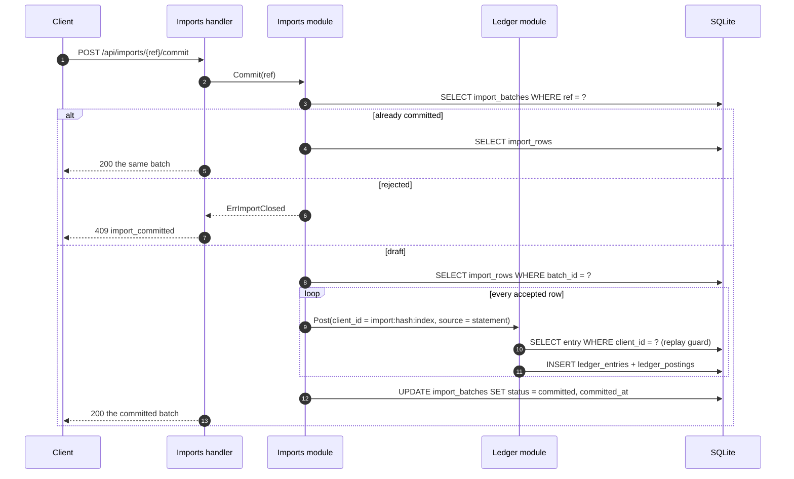

# POST /api/imports/{ref}/commit

**Auth.** Session cookie (`spenicle_session`). Open mode passes everything through; with a password set, a missing or stale cookie is `401 unauthorized`.

## Purpose

Finish the draft: every row the user accepted becomes one ledger entry, and the batch turns `committed`. Replaying the call is safe — the rows carry a `client_id`, so a second commit posts nothing and returns the same batch.

## Upstream

The review screen's "commit" button; a script that retries after a timeout, which is exactly why the reply is replayable.

## Downstream

`Module.Imports.Commit`: read the batch; a `committed` batch returns as-is, a `rejected` one is `409`; otherwise, for each row with `status = accepted`, `ledger.Post` with

- `client_id = import:<file_hash>:<row_index>`,
- `source = statement`, `occurred_on` from the row, note = the description, payee when one was patched,
- currency = the batch currency (the locked base currency),
- postings `[{account_ref, -amount_minor}, {category_ref or Unsorted, +amount_minor}]`.

Then `Repository.Sqlite.CloseImportBatch` stamps `status = committed` and `committed_at`.

## Path / query params

`{ref}` is the batch ref (32 lowercase hex).

## Body

None.

## Response

`200` with the batch document (rows included, `status: "committed"`, `committed_at` set). A replay answers the identical document: the second call finds `status = committed` and stops before the ledger.

Rows that were `pending` or `skipped` are not posted and stay in the batch for audit — a `skipped` row is how the shell keeps the reason it did not post something.

## Errors

- `409 import_committed` — the batch is `rejected`; a rejected batch never posts.
- `404 not_found` — the ref names no batch.
- `422 invalid_postings`, `422 unknown_currency`, `422 invalid_rate` — a row could not become a balanced entry (a deleted account, a category that is not an account); nothing after it is posted and the batch stays `draft`, so the fix is a `PATCH` and a retry.

## Limitations

Not one transaction: the ledger writes are per-row entries, so a failure halfway leaves the rows already posted behind. That is deliberate — each row is its own `client_id`, so retrying the commit resumes instead of duplicating, and a partial commit is visible as a draft that is half posted. No partial-failure report in the response yet.

## Sequence

