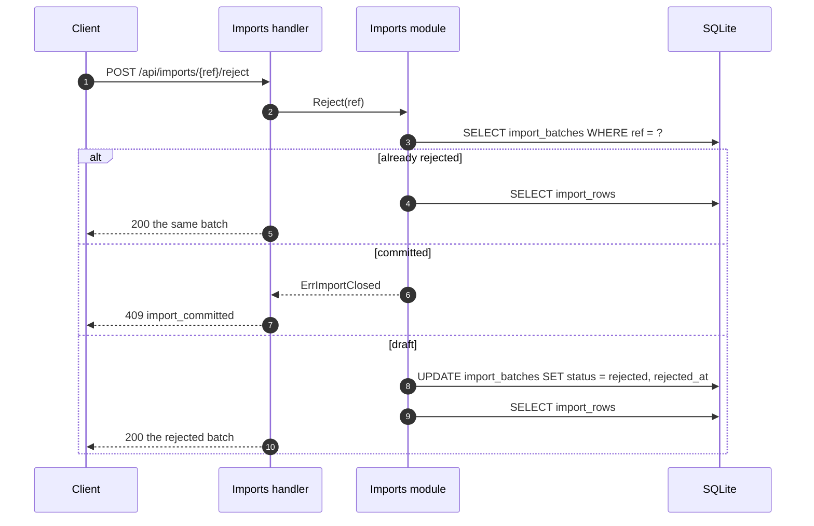

# POST /api/imports/{ref}/reject

**Auth.** Session cookie (`spenicle_session`). Open mode passes everything through; with a password set, a missing or stale cookie is `401 unauthorized`.

## Purpose

Throw the draft away without losing the evidence: the batch turns `rejected`, `rejected_at` is stamped, and the rows and the file hash stay for audit. Idempotent — a second call answers the same document.

## Upstream

The review screen's "discard" button; a script that gives up on a file it cannot parse.

## Downstream

`Module.Imports.Reject`: a `rejected` batch returns as-is, a `committed` one is `409`, and a `draft` is closed with `Repository.Sqlite.CloseImportBatch(ref, rejected, now)`. Rows are not touched. The blob and the rows are reclaimed later by the worker, once `expires_at` has passed and the batch is still a draft — a rejected batch keeps its rows.

## Path / query params

`{ref}` is the batch ref (32 lowercase hex).

## Body

None.

## Response

`200` with the batch document (rows included, `status: "rejected"`, `rejected_at` set).

## Errors

- `409 import_committed` — the batch is `committed`; its entries are in the ledger and the way out of those is `PATCH /api/entries/{ref}` with `{"void": true}`.
- `404 not_found` — the ref names no batch.

## Limitations

Rejected rows are not deletable one by one and the batch cannot be reopened: upload the file again under a new `client_id` (a fresh draft recomputes the clashes). The response is the whole batch, so a client can show what was thrown away.

## Sequence

