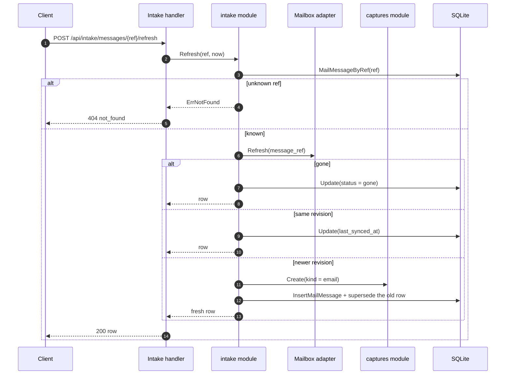

# POST /api/intake/messages/{ref}/refresh

**Auth.** `Authorization: Bearer <credential>`: the instance password, or a token carrying this route's scope. Open mode passes everything through; with a password set, a missing or wrong credential is `401 unauthorized`, and a token without the scope is `403 forbidden`. This route lives in the root-only group, so only the instance password reaches it.

## Purpose

Ask the provider for one message again and record what changed. This is how an amended mail
becomes a fresh capture, and how a deleted one is marked instead of silently kept.

## Upstream

An operator re-reading one mail, or an agent that wants the latest state of a reference.

## Downstream

`Module.Intake.Refresh` → `Repository.Mailbox.Refresh` (one message) → `Module.Captures.Create`
when the revision moved → `Repository.Sqlite.UpdateMailMessage` to stamp the outcome.

## Path / query params

| name | notes |
| --- | --- |
| `ref` | the mail reference (32 lowercase hex) |

## Body

None.

## Response

**200** the same shape as `GET /api/intake/messages/{ref}`.

Behaviour, by what the provider answers:

| provider | outcome |
| --- | --- |
| same revision | the stored row, only `last_synced_at` moves |
| newer revision | a **new** row whose ref is returned; the old row gets `superseded_by` |
| message gone | the stored row, `status: gone` |
| call failed | the stored row, `attempts` incremented and the row's error recorded |

## Errors

- `404 not_found` — no reference with that ref.
- `422 invalid_request` — the ref is not 32 lowercase hex.
- `500 internal_error` — the provider call failed in a way the row could not record.

## Limitations

- A refresh never mutates a capture and never touches the ledger: the new revision is a new
  capture that still needs approval.
- An amendment is detected by the provider's revision handle, not by comparing content, so a
  provider that does not move its revision will report `unchanged`.

## Sequence

