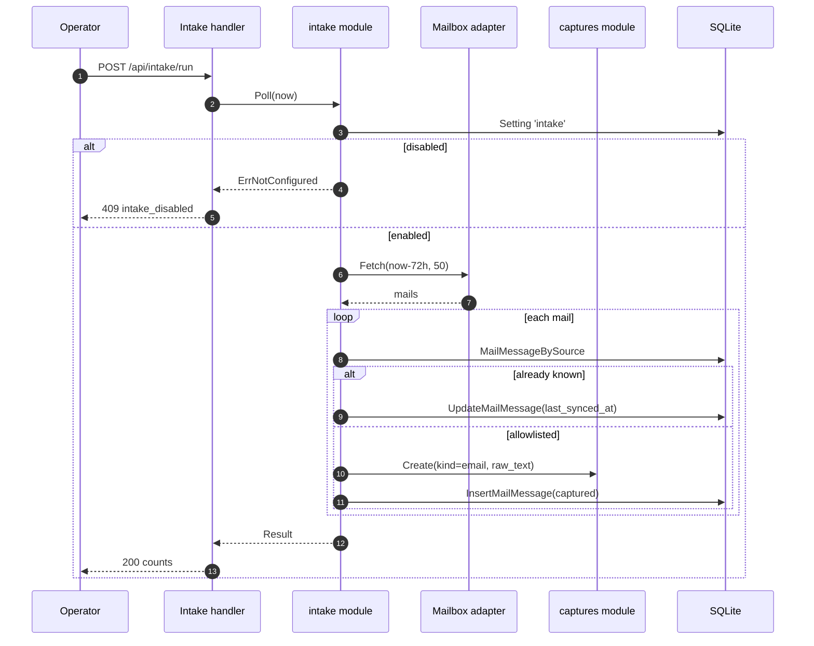

# POST /api/intake/run

**Auth.** `Authorization: Bearer <credential>`: the instance password, or a token carrying this route's scope. Open mode passes everything through; with a password set, a missing or wrong credential is `401 unauthorized`, and a token without the scope is `403 forbidden`. This route lives in the root-only group, so only the instance password reaches it.

## Purpose

Poll the mailbox once, now, and report what happened. This is the same call the worker makes
on its interval — the route exists so a human can prove the wiring before trusting the timer.

## Upstream

The settings screen's "poll now", and the worker's recurring tick.

## Downstream

`Module.Intake.Poll` → `Repository.Mailbox.Fetch` (the configured provider) →
`Module.Captures.Create` per accepted message → `Repository.Sqlite.InsertMailMessage` for the
reference row.

## Path / query params

None.

## Body

None.

## Response

**200** `{"created":1,"skipped":0,"failed":0,"unchanged":0}`

- `created` — a capture was queued. Nothing reached the ledger; approval still does that.
- `skipped` — an allowlist miss, an empty body or a capture the dedupe key already knew.
- `unchanged` — this message was polled before; only its `last_synced_at` moved.
- `failed` — the capture call refused; the row carries the reason.

## Errors

- `409 intake_disabled` — polling is off; turn it on with `PATCH /api/intake` first.
- `500 internal_error` — the provider call failed, or the store refused a write.

## Limitations

- Bounded by design: the window is the last 72h and one run handles at most 50 messages, so a
  backlog drains over several ticks rather than in one call.
- No paging cursor is returned; a poll that fills the burst simply reports what it did and the
  next run picks up the rest.
- Attachments are not captured yet: only a `text/plain` body becomes `raw_text`.

## Sequence

