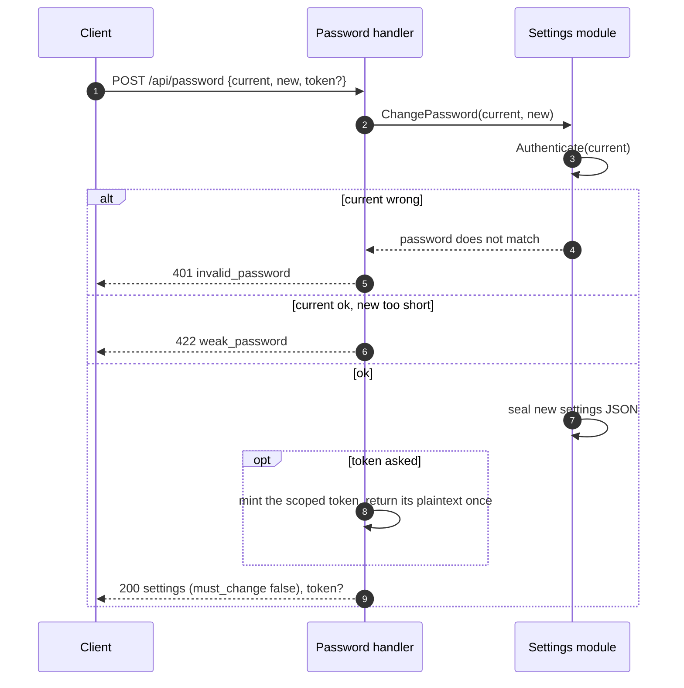

# POST /api/password

**Auth.** **The instance password only** — this is a root-only route, so a token is `403 forbidden` ("this route needs the root credential"), even with `admin` or `*`. Open mode passes everything through; with a password set, a missing or wrong credential is `401 unauthorized`.
## Purpose

Rotate the instance password. Optionally mint the browser credential in the same call,
so a client that just signed in does not need a second request.

## Upstream

The forced change screen after the first sign-in.

## Downstream

`Module.Settings.ChangePassword` → re-seal and upsert `app_settings`.

## Path / query params

None.

## Body

| field | type | required | notes |
| --- | --- | --- | --- |
| `current_password` | string | yes | verified first |
| `new_password` | string | yes | ≥ 12 characters |
| `token` | object | no | `{name, scopes, expires_at?}`, the same shape `POST /api/tokens` takes; when present the plaintext is returned once in this response |

## Response

Without `token`:
`{"base_currency":"IDR","timezone":"UTC","extraction_enabled":false,"ai_assistance":false}`

With `token`, the settings block plus the minted credential:
`{"base_currency":"IDR","timezone":"UTC","extraction_enabled":false,"ai_assistance":false,"token":{"ref":"…","name":"spenicle web","preview":"spl_ab12…9f3c","scopes":["admin"],"created_at":"…","token":"spl_…"}}`

## Errors

`401 invalid_password` (wrong current, or no password set); `422 invalid_request` for a
`new_password` under 12 or over 200 characters (binding); `422 weak_password` when the raw
value passes but trims below 12; `400 invalid_json`.

## Limitations

No history, no reuse check, no "sign out other devices" — the root credential is derived
from the password hash, so every existing credential dies at once. Without `token` the
response carries no credential, so a client sends the new password as the Bearer
credential on the next request; with `token` it gets a revocable one instead and never
stores the password.

A fresh instance has no password: this route answers `401 invalid_password` until
[`POST /api/setup`](./POST_api_setup.md) has set one.

---

## Sequence

