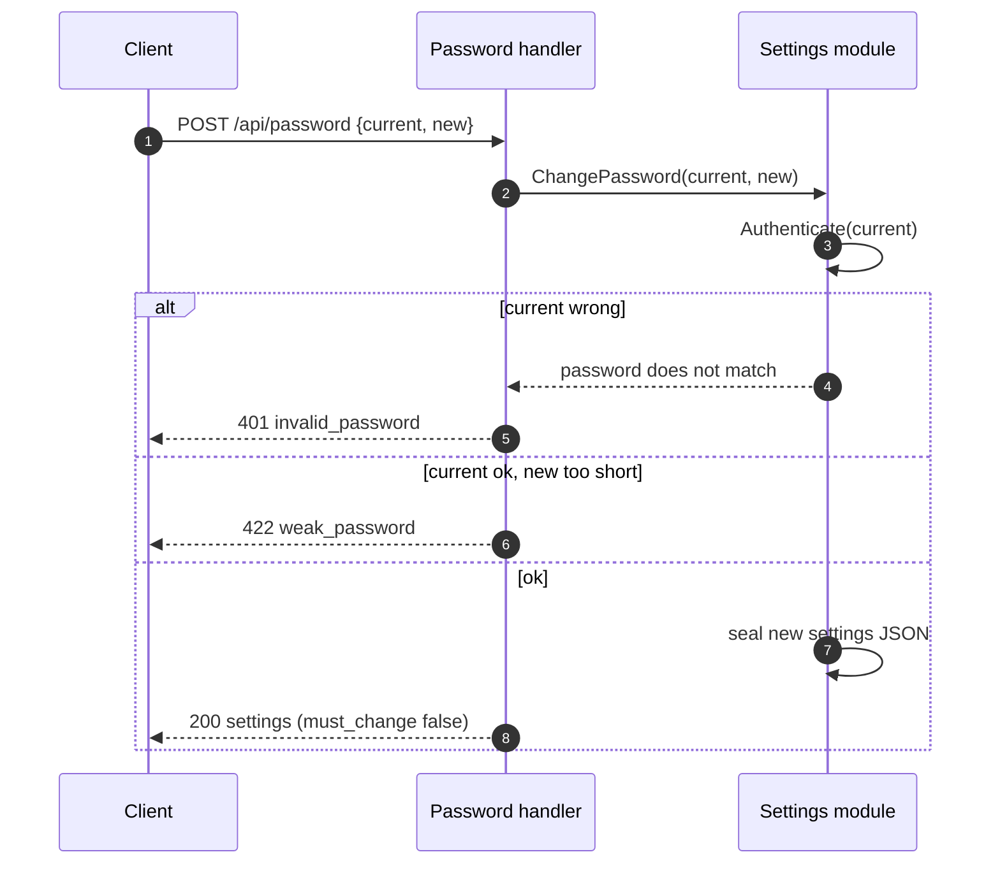

# POST /api/password

**Auth.** **The instance password only** — this is a root-only route, so a token is `403 forbidden` ("this route needs the root credential"), even with `admin` or `*`. Open mode passes everything through; with a password set, a missing or wrong credential is `401 unauthorized`.
## Purpose

Replace the generated password with the user's own and clear
`password_must_change`.

## Upstream

The forced change screen after the first sign-in.

## Downstream

`Module.Settings.ChangePassword` → re-seal and upsert `app_settings`.

## Path / query params

None.

## Body

| field | type | required | notes |
| --- | --- | --- | --- |
| `current_password` | string | yes | verified first |
| `new_password` | string | yes | ≥ 12 characters |

## Response

`{"base_currency":"IDR","timezone":"UTC","password_must_change":false,"extraction_enabled":false,"ai_assistance":false}`

## Errors

`401 invalid_password` (wrong current, or no password set);
`422 weak_password`; `400 invalid_json`.

## Limitations

No history, no reuse check, no "sign out other devices" — the root credential is derived
from the password hash, so every existing credential dies at once. Send the new password
as the Bearer credential on the next request; the response does not carry a token.

---

## Sequence

