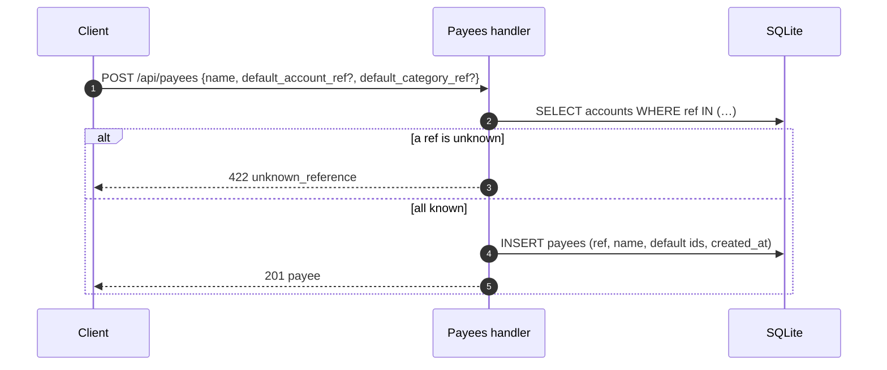

# POST /api/payees

**Auth.** `Authorization: Bearer <credential>`: the instance password, or a token carrying this route's scope. Open mode passes everything through; with a password set, a missing or wrong credential is `401 unauthorized`, and a token without the scope is `403 forbidden`.

## Purpose

Create the "who" of a transaction — the merchant, the landlord, the coffee shop — with
optional defaults, so approving a capture can pre-fill the account and category.

## Upstream

The payee sheet, an agent turning "KOPI KENANGAN" from a capture into a reusable row.

## Downstream

`Repository.Sqlite.CreatePayee`: `payees` row with a fresh `ref`; the two default refs
are resolved to internal ids first, so an unknown ref fails before the insert.

## Path / query params

None.

## Body

| field | type | required | notes |
| --- | --- | --- | --- |
| `name` | string | yes | ≤ 80 characters, unique |
| `default_account_ref` | string | no | the account money usually leaves from |
| `default_category_ref` | string | no | the account (`expense`/`income`) it lands in |

## Response

**201** `{"ref":"…","name":"Kopi Kenangan","default_category_ref":"…","archived":false,"created_at":"…"}`

## Errors

`422 invalid_request` for a missing name, and for a `default_category_ref` that names an
`asset`/`liability` account (a category must be `expense` or `income`); `422 unknown_reference`
when a default points at an account nobody owns; `409 duplicate` when that `name` already
exists (`payees.name` is unique).

## Limitations

No editing of the defaults here (see `PATCH /api/payees/{ref}`), no merge of two
payees, and no autocomplete endpoint — the payee list ships inside `GET /api/meta`.

## Sequence

