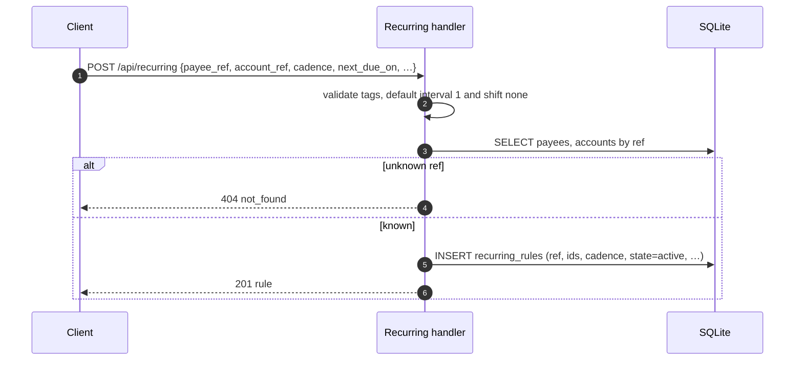

# POST /api/recurring

**Auth.** `Authorization: Bearer <credential>`: the root credential from `POST /api/session`, or a token carrying this route's scope. Open mode passes everything through; with a password set, a missing or stale credential is `401 unauthorized`, and a token without the scope is `403 forbidden`.

## Purpose

Record a rule that repeats: rent every month on the 1st, a subscription every year, a
weekly allowance. The rule is a plan, not a posting — nothing reaches the ledger until
a due date is materialised.

## Upstream

"Make this recurring" on an entry, the recurring screen, an agent that noticed the same
merchant three months running.

## Downstream

`Repository.Sqlite.CreateRecurring`: resolves `payee_ref` and the account refs, then one
`recurring_rules` row with `origin = user` and `state = active`.

## Path / query params

None.

## Body

| field | type | required | notes |
| --- | --- | --- | --- |
| `payee_ref` | string | yes | who gets paid |
| `account_ref` | string | yes | where the money leaves from |
| `category_ref` | string | no | the `expense`/`income` account it lands in |
| `amount_minor` | string | yes | integer minor units, signed |
| `currency` | string | yes | ISO 4217 |
| `cadence` | string | yes | `weekly`, `monthly`, `yearly` |
| `interval_n` | int | no | every N cadences, default 1 |
| `day_of_month` | int | no | 1–31, for monthly rules |
| `business_day_shift` | string | no | `none` (default), `next`, `prev` |
| `next_due_on` | string | yes | `YYYY-MM-DD` |
| `ends_on` | string | no | `YYYY-MM-DD` |

## Response

**201** the rule: `ref`, both refs, `amount_minor`, `cadence`, `interval_n`,
`day_of_month`, `business_day_shift`, `next_due_on`, `ends_on`, `origin: user`,
`state: active`, `created_at`.

## Errors

`422 invalid_request` for an unknown cadence, shift, a `day_of_month` outside 1–31 or a
malformed date; `404 not_found` when `payee_ref` or an account ref does not exist.

## Limitations

No automatic posting yet: `state` and `next_due_on` are data, and the scheduler that
would turn a due rule into an entry is not implemented. No `detected` origin either —
that is the promotion path from a capture.

## Sequence

