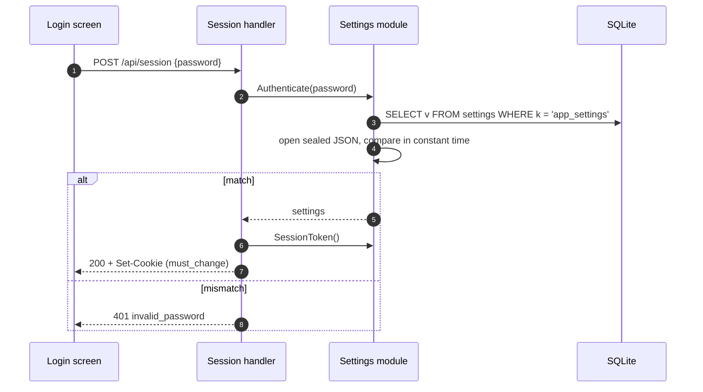

# POST /api/session

**Auth.** None: the route answers without a password.

## Purpose

Exchange the password for a session cookie. The first password is
generated at boot, printed once in the log, and flagged `must_change`.

## Upstream

Login screen, scripts that want a cookie.

## Downstream

`Module.Settings.Authenticate` → `settings` row (sealed JSON, opened
with `APP_SECRET`), then `Module.Settings.SessionToken`.

## Path / query params

None.

## Body

| field | type | required | notes |
| --- | --- | --- | --- |
| `password` | string | yes | verified against the stored PBKDF2-SHA256 hash, constant time |

## Response

`{"status":"signed_in","must_change":true,"extraction_enabled":false,"ai_assistance":false}`
+ `Set-Cookie: spenicle_session=…`
(`HttpOnly`, `SameSite=Lax`, `Secure` when served over TLS or when `X-Forwarded-Proto`
says so, 30 days, `Cache-Control: no-store`).

## Errors

`401 invalid_password`; `409 no_password_set` when the instance is in open
mode; `400 invalid_json`; `403 cross_origin_denied` for a mutating request from another
origin.

## Limitations

No rate limiting yet; one user, no usernames. The cookie value is not
a database row: it is `sha256(fingerprint, password hash)` truncated, so it cannot be
revoked per device — changing the password rotates it for everyone.

---

## Sequence

