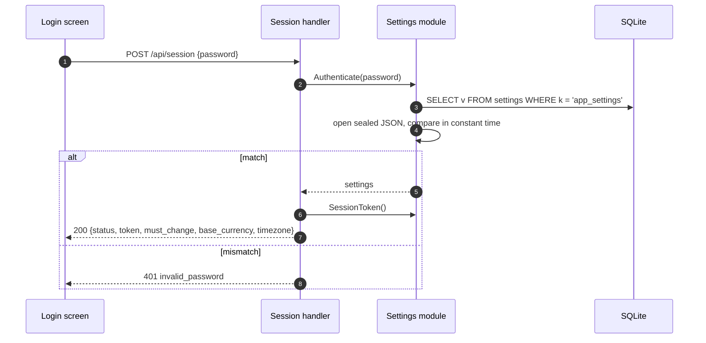

# POST /api/session

**Auth.** None: the route answers without a credential.

## Purpose

Exchange the password for the **root credential**. It is the only way to obtain one; the
first password is generated at boot, printed once in the log, and flagged `must_change`.

## Upstream

Login screen, scripts that want the root credential.

## Downstream

`Module.Settings.Authenticate` → the `app_settings` row (sealed JSON, opened with
`APP_SECRET`) compared in constant time, then `Module.Settings.SessionToken`, which derives
the credential from `APP_SECRET`'s fingerprint and the stored password hash.

## Path / query params

None.

## Body

| field | type | required | notes |
| --- | --- | --- | --- |
| `password` | string | yes | verified against the stored PBKDF2-SHA256 hash, constant time |

## Response

`200` with `status`, **`token`** (the root credential), `must_change`, `base_currency`,
`timezone`, `extraction_enabled`, `ai_assistance`. There is no `Set-Cookie`: the caller
keeps the token and sends it as `Authorization: Bearer <token>` on every request, exactly
like an API token.

`base_currency` and `timezone` are always present, never omitted: the shell reads them
from the sign-in answer instead of a second round trip. Both are the stored values, so the
credential never disagrees with `GET /api/settings`.

## Errors

`401 invalid_password`; `409 no_password_set` when the instance is in open mode;
`400 invalid_json`.

## Limitations

No rate limiting yet; one user, no usernames. The credential is not a database row: it is
`sha256(fingerprint, password hash)` truncated, so it cannot be revoked per device —
changing the password rotates it for everyone, and signing out is dropping it. While
`must_change` is set, every route except `POST /api/password` answers
`409 password_change_required`.

## Sequence

