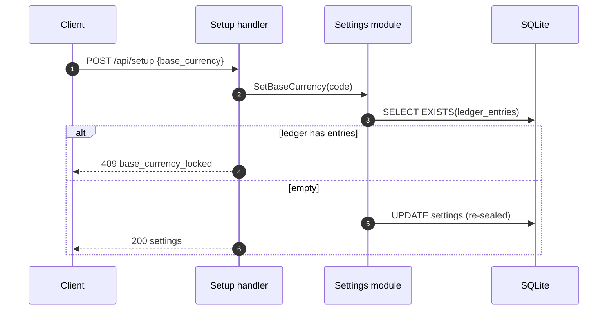

# POST /api/setup

**Auth.** `Authorization: Bearer <credential>`: the root credential from `POST /api/session`, or a token carrying this route's scope. Open mode passes everything through; with a password set, a missing or stale credential is `401 unauthorized`, and a token without the scope is `403 forbidden`.

## Purpose

Open the ledger: choose the base currency before the first entry. It is a one-shot
wizard step — the same call answers `409` the moment the ledger has any entry.

## Upstream

The first-run screen.

## Downstream

`Module.Settings.SetBaseCurrency`: `HasEntries` guard, then re-seal the settings row.

## Path / query params

None.

## Body

| field | type | required | notes |
| --- | --- | --- | --- |
| `base_currency` | string | yes | ISO 4217, case-insensitive; `empty_setup` when absent |

## Response

**200** `{"base_currency":"USD","timezone":"UTC","password_must_change":false,"extraction_enabled":false,"ai_assistance":false}`

## Errors

`422 empty_setup` when the body carries nothing; `409 base_currency_locked` once an
entry exists; `422 unknown_currency` for a code this build does not know.

## Limitations

Only the currency: first account and opening balance are not part of this route yet, and
the base currency cannot be changed afterwards (voiding entries does not unlock it). It is
set exactly once here; `PATCH /api/settings` refuses it, and `timezone` is never settable
through the API. Both fields stay in every settings payload, with no `omitempty`, so a
client never has to guess a missing default.

## Sequence

