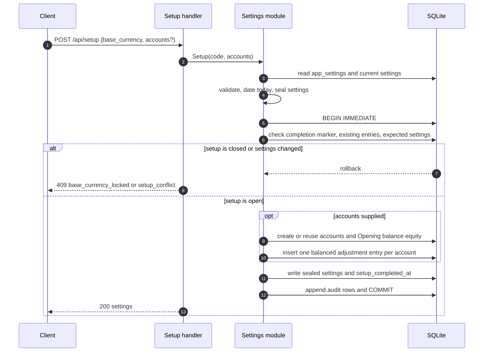

# POST /api/setup

**Auth.** `Authorization: Bearer <credential>`: the instance password, or a token carrying this route's scope. Open mode passes everything through; with a password set, a missing or wrong credential is `401 unauthorized`, and a token without the scope is `403 forbidden`.

## Purpose

Open the ledger once: choose the base currency and optionally seed accounts with
opening balances. The currency, accounts, balanced entries, settings and completion
marker commit together; a second call is `409 base_currency_locked` even when the
first call created no entries.

## Upstream

The first-run wizard.

## Downstream

`Module.Settings.Setup`: read the current sealed settings, validate the request,
compute today's date in the stored timezone, then call
`Repository.Sqlite.CompleteSetup` under `BEGIN IMMEDIATE`.

## Path / query params

None.

## Body

| field | type | required | notes |
| --- | --- | --- | --- |
| `base_currency` | string | yes | ISO 4217, case-insensitive; `empty_setup` when absent |
| `accounts` | array | no | at most 100 opening accounts |
| `accounts[].name` | string | yes | trimmed, ≤ 80 characters; unique per `kind` in the request |
| `accounts[].kind` | string | yes | `asset`, `liability`, `equity`, `expense`, `income` |
| `accounts[].opening_balance_minor` | string | yes | nonzero signed minor units; wire money is a string |

`Opening balance` is reserved for the equity account the server creates as the
contra account. Existing non-archived accounts are reused by `name` + `kind` and
updated to the chosen base currency. An archived match refuses the whole setup.
Opening entries are dated today in `APP_TIMEZONE`; the client cannot backdate them.

## Response

**200** `{"base_currency":"USD","timezone":"UTC","password_must_change":false,"extraction_enabled":false,"ai_assistance":false}`

## Errors

`422 empty_setup` when `base_currency` is absent; `422 unknown_currency` for a code
this build does not know; `422 invalid_request` for an invalid account, duplicate
`name` + `kind`, zero balance or the reserved account name; `409 base_currency_locked`
once setup has completed or a legacy database already has entries; `409 invalid_state`
when a matching account is archived; `409 setup_conflict` when settings changed while
the request was being saved.

## Limitations

Accounts are optional: currency-only setup remains valid and still locks the ledger.
Each requested account receives one `adjustment` entry with two postings, against the
dedicated `Opening balance` equity account. No opening equity account is created for
currency-only setup. The base currency cannot be changed afterwards, voiding entries
does not unlock it, and `PATCH /api/settings` refuses it. `timezone` is never settable
through the API. Both fields stay in every settings payload, with no `omitempty`, so a
client never has to guess a missing default.

## Sequence

