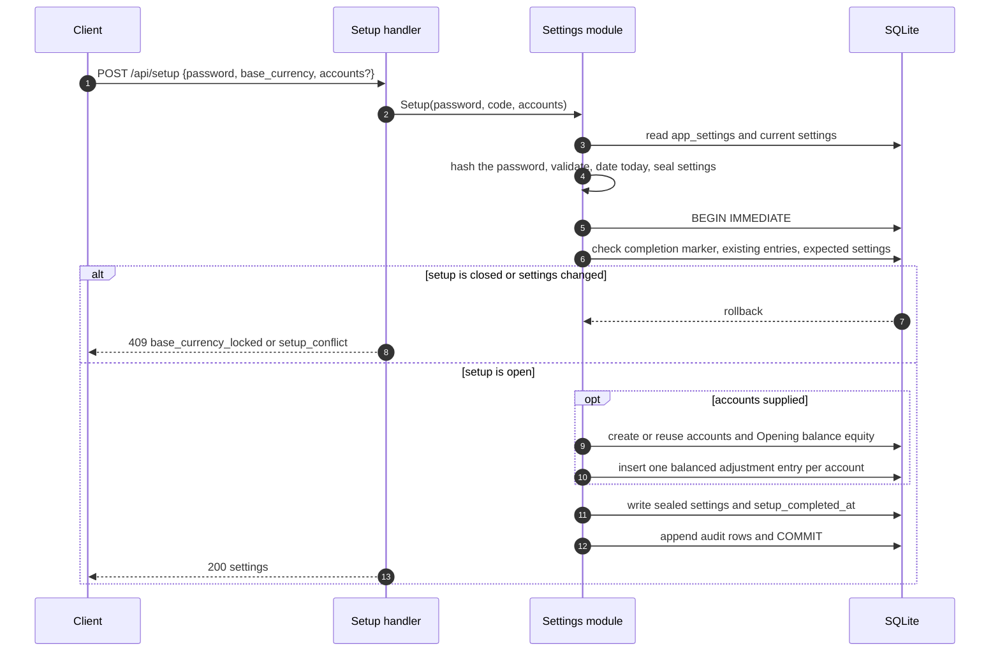

# POST /api/setup

**Auth.** Root only: the instance password, or nothing at all while the instance is open. A fresh database has **no password** — this route is what creates it — so the first call needs no header. Once a password is set, a missing or wrong credential is `401 unauthorized`, and a token is `403 forbidden` ("this route needs the root credential"), even with `admin` or `*`.

## Purpose

Claim the instance: set its password, choose the base currency and optionally seed
accounts with opening balances. The password hash, the currency, the accounts, the
balanced entries, the settings and the completion marker commit together, so a
half-claimed instance cannot exist; a second call is `409 base_currency_locked` even
when the first call created no entries.

## Upstream

The first-run wizard.

## Downstream

`Module.Settings.Setup`: read the current sealed settings, validate the request,
compute today's date in the stored timezone, then call
`Repository.Sqlite.CompleteSetup` under `BEGIN IMMEDIATE`.

## Path / query params

None.

## Body

| field | type | required | notes |
| --- | --- | --- | --- |
| `password` | string | yes | 12–200 characters, trimmed; becomes the root credential as a PBKDF2 hash inside the sealed settings row |
| `base_currency` | string | yes | ISO 4217, case-insensitive; `empty_setup` when absent |
| `accounts` | array | no | at most 100 opening accounts |
| `accounts[].name` | string | yes | trimmed, ≤ 80 characters; unique per `kind` in the request |
| `accounts[].kind` | string | yes | `asset`, `liability`, `equity`, `expense`, `income` |
| `accounts[].opening_balance_minor` | string | yes | nonzero signed minor units; wire money is a string |

`Opening balance` is reserved for the equity account the server creates as the
contra account. Existing non-archived accounts are reused by `name` + `kind` and
updated to the chosen base currency. An archived match refuses the whole setup.
Opening entries are dated today in `APP_TIMEZONE`; the client cannot backdate them.

## Response

**200** `{"base_currency":"USD","timezone":"UTC","extraction_enabled":false,"ai_assistance":false}`

The response carries no credential: the caller sends the password it just chose as its
next `Authorization: Bearer`, or exchanges it for a token at [`POST /api/tokens`](./POST_api_tokens.md).

## Errors

`422 weak_password` when the password is absent, under 12 characters or over 200;
`422 empty_setup` when `base_currency` is absent; `422 invalid_request` for a currency
code this build does not know (binding rejects it before the module runs), for an invalid account, duplicate
`name` + `kind`, zero balance or the reserved account name; `409 base_currency_locked`
once setup has completed or a legacy database already has entries; `409 invalid_state`
when a matching account is archived; `409 setup_conflict` when settings changed while
the request was being saved.

## Limitations

**A fresh instance is open until this call lands.** There is no generated password and
no claim file: `GET /api/bootstrap` answers `setup_completed: false`, and every request
is the root credential until the first setup sets one. Start the container on a network
you trust, or complete this call before exposing the port — that window is the price of
never having a password nobody chose.

Accounts are optional: currency-only setup remains valid and still locks the ledger.
Each requested account receives one `adjustment` entry with two postings, against the
dedicated `Opening balance` equity account. No opening equity account is created for
currency-only setup. The base currency cannot be changed afterwards, reversing entries
does not unlock it, and `PATCH /api/settings` refuses it. `timezone` is never settable
through the API. Both fields stay in every settings payload, with no `omitempty`, so a
client never has to guess a missing default.

## Sequence

