# Spenicle v2 — Data model & API

Companion to [`v2-design.md`](./v2-design.md). Operational docs: [`../README.md`](../README.md).

**25 tables plus `schema_migrations`, 59 routes** (one of them `/healthz`).

Base path `/api`. No version prefix: we are the only consumer, and an agent can adapt to a
change faster than a `/v2` namespace can justify itself. Dates `YYYY-MM-DD`, timestamps ISO
8601 UTC. Money crosses the wire as **minor-unit strings** (`"25000"`) plus a currency code,
never floats. Errors: `{"error":{"code":"...","message":"...","details":{}}}`. A `500` always
carries the generic message `internal error`: the cause is written to the structured log,
never to the client.

Implemented contract, one entry per live route with upstream/downstream, params, body,
limitations and a sequence diagram: [`endpoints.md`](./endpoints.md).

## Implementation status

Legend: **live** = shipped and covered by UAT, **partial** = some actions only,
**next** = designed, not written yet.

| # | endpoint | state |
| --- | --- | --- |
| 3 | `GET /api/meta` | live |
| 9 | `GET /api/entries` | live (filters, cursor, limit) |
| 9 | `GET /api/entries/{ref}` | live: one entry with its postings, `404` for an unknown ref |
| 10 | `POST /api/entries` | live |
| 11 | `PATCH /api/entries/{ref}` | live: `void` (writes the reversal) and `payee_ref` |
| 12 | `GET /api/captures` | live (status filter, cursor, limit) |
| 13 | `POST /api/captures` | live: JSON text or multipart `file`, submitted to SnapToJSON when configured |
| 14 | `PATCH /api/captures/{ref}` | live: `approve`, `reject`, `retry`, `match`; an approved recurring capture resolves its rule from the sealed draft |
| 21 | `GET /healthz` | live |
| 22 | `POST/GET /api/exports`, `GET /api/exports/{ref}`, `GET /api/exports/{ref}/events`, `GET /api/exports/{ref}/download` | live: the worker renders a job into one JSON document or a zip of CSV sheets plus `summary.json` and `manifest.json`, an append-only event log records every step, idempotent by `client_id` |
| 25 | `POST/GET /api/imports`, `GET /api/imports/{ref}`, `PATCH /api/imports/{ref}/rows/{index}`, `PATCH /api/imports/{ref}`, `GET /api/imports/{ref}/events` | live: a CSV statement drafts rows, one review action (`commit` or `reject`) closes it, an append-only event log records every step, idempotent by `client_id` |
| 1 | `POST /api/setup` | live: chooses the base currency once and optionally posts opening balances before setup completes |
| 2 | `POST /api/password` | live: password rotation; the password itself is the root credential |
| 4 | `GET/PATCH /api/settings` | `GET` is live; `PATCH` accepts no field yet — `base_currency` is not patchable |
| 5, 6 | accounts create/patch | live |
| 7, 8 | payees | live |
| 15, 16 | recurring | live: a due rule queues a `captures` row and never posts the ledger; the approval posts it |
| 17, 18 | `GET /api/analytics/months`, dashboard | live |
| 19, 20 | `POST/GET /api/tokens`, `POST /api/tokens/{ref}/revoke` | live: root credential only, scoped Bearer credential, digest stored, masked preview, `last_used_at`, revoke never deletes |
| — | `GET /api/audit` | live: the journal, filtered by kind, ref, action, actor and a day range |
| — | `GET/PATCH /api/intake`, `POST /api/intake/run`, `GET /api/intake/messages`, `GET /api/intake/messages/{ref}`, `POST /api/intake/messages/{ref}/refresh` | live: a mailbox poll queues captures, a reference records what became of each mail |
| — | `GET /api/connections`, `POST /api/connections/google`, `GET /api/connections/google/callback`, `POST /api/connections/{ref}/revoke` | live: one sealed credential per provider, re-authorising replaces it |
| — | `GET/POST /api/categorization/rules`, `PATCH /api/categorization/rules/{ref}`, `GET /api/categorization/suggest` | live: deterministic rules suggest a category, the suggestion endpoint explains the tier and never posts |

## Review rounds folded in

| was | now | why |
| --- | --- | --- |
| `inbox_items` | `captures` | names the thing, not the container |
| `extractions` table | `capture_payloads`, one sealed child row per capture | the capture keeps its state, the vendor payload stays 1:1 and never widens the queue row |
| `currencies` table | embedded ISO 4217 list | static data belongs in the binary |
| `periods`, `closed_periods`, `month_closes` | none | each attempt at a lock or snapshot got deleted; the ledger is the truth |
| 28 endpoints | 59 live routes | actions moved into the body, and more surfaces were added |
| session-only auth | one `Authorization: Bearer` header, root credential **or** scoped API token | no cookie, no second transport |
| plaintext captures and artifacts | sealed with `APP_SECRET` | bank emails and receipts are the sensitive part |
| `/api/v2/...` | `/api/...` | no version prefix |

## Runtime configuration

| env | default | effect |
| --- | --- | --- |
| `APP_SECRET` | **required** | seals capture payloads and artifacts; keys the root credential and the token digests |
| `APP_TIMEZONE` | `UTC` | the calendar every date decision uses; set once, at the first boot |
| `SNAPTOJSON_API_KEY` | unset | enables the SnapToJSON extraction rail |
| `SNAPTOJSON_ENDPOINT` | vendor route | override the partner URL (proxy, staging) |
| `OPENAI_API_KEY` | unset | reserved for the chat rail; `config.SelectRail` never builds the OpenAI rail |
| `OPENAI_MODEL` | `gpt-4o-mini` | model the reserved OpenAI adapter asks for |
| `OPENAI_HOST` | unset | base URL for the reserved OpenAI adapter; empty keeps the SDK default |
| `OTEL_EXPORTER_OTLP_ENDPOINT` | unset | OTLP/HTTP collector; empty makes tracing and metrics no-ops |

The listen address (`:8080`), the data directory (`./data`), the DB path, artifact/export/import
stores, retention and size caps, HTTP timeouts, shutdown budgets, health timeout, body and row
caps, pool sizes and the worker interval are **not** environment variables: they are constants
in `internal/common/config/config.go`, resolved into `entity.AppConfig`. The container works
in `/data`, which is the volume.

Names carry no prefix on purpose. If several self-hosted services share one `env_file`, qualify
them yourself — `spenicle.env` is the cheapest separator.
### What `APP_SECRET` seals

| sealed | how |
| --- | --- |
| the root credential | HMAC-SHA256 over the password hash; changing the password invalidates it |
| `capture_payloads.raw_text`, `capture_payloads.draft_json`, `captures.resolution_note` | AES-256-GCM per row, `v1:` + base64 envelope |
| `artifacts/<sha256>` files | AES-256-GCM, key = HKDF-SHA256(secret, info `spenicle/artifact/v1`), sha256 as AAD |
| `api_tokens.token_hash` | HMAC-SHA256(secret, token), not bare sha256 |

Deliberately **not** sealed: `ledger_entries`, `ledger_postings`, `accounts`, `amounts`. Your
numbers stay readable with `sqlite3`, so a lost secret never costs you your financial history.

Consequences, stated plainly:

1. Losing the secret loses capture payloads and receipt images. The ledger survives. Back the
   secret up next to the database.
2. Changing the secret is refused at boot (`settings.secret_fingerprint` mismatch). Without the
   old secret there is no re-encryption path and no in-place reset: restore the original, or
   delete `spenicle.db` and start over. The ledger you keep is the one you backed up.
3. Whole-file encryption is **not** offered: `modernc.org/sqlite` has no codec, and SQLCipher
   needs cgo, which breaks the static single binary. Use LUKS on the volume if you want that.

## Auth

| credential | used by | transport |
| --- | --- | --- |
| the instance password (root) | a client, `curl`, whoever holds it | **every** request sends `Authorization: Bearer <password>`; skipped while no password is set (open mode); a verified password is cached in memory so PBKDF2 runs once per process |
| API token | agents, scripts, cron | the same header; the token store decides its scopes |

There is no cookie, no exchange route and no second transport: the header is the only place
a credential travels, and the root one is the password itself. `POST /api/password` rotates
it (and clears the verification cache by construction); signing out is dropping it.

Scopes: `entries:read|write`, `captures:read|write`, `accounts:read|write`, `payees:read|write`,
`recurring:read|write`, `imports:read|write`, `exports:read|write`, `analytics:read|write`,
`categorization:read|write`, `audit:read`, `dashboard:read`, `settings:read`, `rates:read`,
`admin`, plus `*`.

The route scope is the floor, not the whole answer: a handler declares any extra scope the
action needs. `PATCH /api/captures/{ref}` needs `entries:write` to approve, `entries:read` to
match, and `payees:write` when approval learns a payee's default category;
`PATCH /api/imports/{ref}` needs `entries:write` to commit; saved custom-query writes need
`analytics:write`; `GET /api/meta` needs every collection scope it returns; and an export
download needs `entries:read` because the artifact is a whole-ledger snapshot. A missing
action scope is `403 forbidden` before the effect happens. `POST /api/setup` is root-only:
its currency lock and opening entries are irreversible and no token can perform it.

Each endpoint declares its route scope when it is registered (`groups.scoped.route(scope, pattern, handler)` in `cmd/http/handler.go`); a subset returns
`403 forbidden`. `admin` and `*` cover every scoped route. Routes with **no** scope live in
their own mux that only the root credential reaches — `/api/setup`, `/api/tokens*`,
`/api/password`, `PATCH /api/settings` and the connection/intake routes — so a token can
never mint another token or lock the currency. The typical capture agent token is
`captures:write` + `dashboard:read`: it can dump receipts and read the dashboard, but cannot
approve them without `entries:write`.

The plaintext token is returned exactly once, by the `201` that created it. Only
`HMAC-SHA256(APP_SECRET-derived key, "spenicle/token/v1\\x00" + token)` is stored, the same
way a password hash is stored. Revoking stamps `revoked_at`: the row stays (and its journal
entry stays), and the credential answers `401 unauthorized` at once.

## Conventions

| concern | rule |
| --- | --- |
| idempotency | caller-supplied `client_id` (≤ 64 chars) on creates; UUIDv7 is a client convention, not a server rule |
| pagination | `?cursor=&limit=` (default 50, max 200), response carries `next_cursor` |
| soft delete | never. `archived_at`, `voided_at`, `status='rejected'` |
| backdated writes | **always allowed**, any month, past or future |
| month close | no lock and no snapshot: the diff is computed from the ledger on every read |
| concurrency | SQLite `BEGIN IMMEDIATE` for writes, WAL for readers |
| deprecated verbs | approve/reject/retry/void/detect are **body actions** on `PATCH` |
| browser clients | `OPTIONS` preflight is answered with `204` before auth; valid `http(s)` and `null` origins are reflected with `Vary: Origin`, `GET, POST, PATCH, OPTIONS` and `Authorization, Content-Type` are allowed, `Content-Disposition` is exposed, and no cookie is set |

---

# 1. Tables

## 1.1 `settings`

| column | type | notes |
| --- | --- | --- |
| `k` | TEXT PK | |
| `v` | TEXT | raw; JSON when structured |

Keys: `app_settings` (a sealed JSON row with `base_currency`, `timezone`,
`password_hash`, `password_must_change` and `extraction_enabled`), `secret_fingerprint`,
`setup_completed_at`, `worker_last_run_at` and `google_client`. `setup_completed_at` is
the authoritative one-shot marker: once set, the base currency is locked even when the
ledger is empty. A legacy database with ledger entries but no marker is also locked.
`timezone` is pinned from `APP_TIMEZONE` at the first boot, and `extraction_enabled`
records that the SnapToJSON rail is configured (`SNAPTOJSON_API_KEY`). The OpenAI
adapter is reserved for a future chat rail and does not run extraction today.


## 1.2 `api_tokens`

| column | type | notes |
| --- | --- | --- |
| `id` | INTEGER PK | |
| `name` | TEXT | `laptop-agent`, `iphone-shortcut` |
| `token_preview` | TEXT | the mask the caller sees, `spl_ab12…9f3c` |
| `token_hash` | TEXT UNIQUE | HMAC-SHA256 under `APP_SECRET` |
| `scopes` | TEXT | space-separated |
| `created_at` | TEXT | |
| `last_used_at` | TEXT NULL | |
| `revoked_at` | TEXT NULL | revoked, never deleted |
| `expires_at` | TEXT NULL | optional expiry, checked on authentication |

## 1.3 `fx_rates`

| column | type | notes |
| --- | --- | --- |
| `base` | TEXT | always `EUR`, PK part |
| `quote` | TEXT | PK part, ISO code |
| `on_date` | TEXT | PK part, TARGET business day |
| `rate` | TEXT | exact decimal, `big.Rat`, never REAL |
| `source` | TEXT | `ecb` \| `manual` |
| `fetched_at` | TEXT | |

No retention needed: ~30 pairs × ~250 business days ≈ 7,500 rows/year, under 1 MB/year. An
optional prune keeps only month-ends older than 5 years. Artifacts are the real disk cost, so
the worker prunes `artifacts/` instead: a rejected capture loses its document after
`ArtifactRetention` (`720h`), 200 rows per run, and the ledger is untouched.

## 1.4 `accounts`

Every table also has `id INTEGER PRIMARY KEY` (the graph) and `ref TEXT NOT NULL UNIQUE`
(a dashless UUID). The API speaks `ref` only: `account_ref`, `ref`, and never a number.

| column | type | notes |
| --- | --- | --- |
| `id` | INTEGER PK | |
| `name` | TEXT | |
| `kind` | TEXT | `asset` \| `liability` \| `equity` \| `expense` \| `income` |
| `parent_id` | INTEGER NULL | self-FK, category hierarchy |
| `currency` | TEXT | ISO code, validated in code against the embedded list |
| `icon` | TEXT NULL | |
| `archived_at` | TEXT NULL | |
| `created_at` | TEXT | |

`UNIQUE(name, kind)`. Expense/income rows are what the UI calls "Categories".

## 1.5 `payees`

| column | type | notes |
| --- | --- | --- |
| `id` | INTEGER PK | |
| `name` | TEXT UNIQUE | |
| `default_account_id` | INTEGER NULL | prefills capture |
| `default_category_id` | INTEGER NULL | prefills capture |
| `archived_at` | TEXT NULL | |
| `created_at` | TEXT | |

## 1.6 `recurring_rules`

| column | type | notes |
| --- | --- | --- |
| `id` | INTEGER PK | |
| `payee_id` | INTEGER | FK |
| `account_id` | INTEGER | FK |
| `category_id` | INTEGER NULL | FK |
| `amount_minor` | INTEGER | signed |
| `currency` | TEXT | ISO code |
| `cadence` | TEXT | `daily` \| `weekly` \| `monthly` \| `yearly` |
| `interval_n` | INTEGER | default 1 |
| `day_of_month` | INTEGER NULL | 1–31 |
| `business_day_shift` | TEXT | `none` \| `next` \| `prev` |
| `next_due_on` | TEXT | drives generation |
| `ends_on` | TEXT NULL | |
| `origin` | TEXT | `user` \| `detected` |
| `state` | TEXT | `suggested` \| `active` \| `paused` \| `ended` |
| `last_posted_on` | TEXT NULL | |
| `created_at` | TEXT | |

## 1.7 `ledger_entries`

| column | type | notes |
| --- | --- | --- |
| `id` | INTEGER PK | |
| `occurred_on` | TEXT | any month, no gate |
| `payee_id` | INTEGER NULL | FK |
| `note` | TEXT NULL | |
| `currency` | TEXT | ISO code of the postings |
| `source` | TEXT | `manual` \| `share` \| `email` \| `statement` \| `recurring` \| `adjustment` |
| `recurring_rule_id` | INTEGER NULL | FK, `UNIQUE(rule, occurred_on)` |
| `client_id` | TEXT NULL | caller-supplied, ≤ 64 chars, `UNIQUE` when set |
| `reverses_entry_id` | INTEGER NULL | self-FK, set on the reversal |
| `voided_at` | TEXT NULL | set on the original |
| `created_at` | TEXT | |

## 1.8 `ledger_postings`

| column | type | notes |
| --- | --- | --- |
| `id` | INTEGER PK | |
| `entry_id` | INTEGER | FK, `ON DELETE RESTRICT` |
| `account_id` | INTEGER | FK |
| `amount_minor` | INTEGER | signed, sums to 0 per entry |
| `base_amount_minor` | INTEGER | signed, sums to 0 per entry |
| `fx_rate` | TEXT | native→base, `'1'` for identity |
| `fx_rate_date` | TEXT NULL | |
| `fx_source` | TEXT | `ecb` \| `cached` \| `manual` \| `identity` |

## 1.9 `captures`

The single review queue. One row per thing captured, from any channel.

| column | type | notes |
| --- | --- | --- |
| `id` | INTEGER PK | |
| `kind` | TEXT | `share` \| `image` \| `email` \| `statement` \| `recurring` \| `manual` |
| `status` | TEXT | `extracting` \| `pending` \| `duplicate` \| `approved` \| `rejected` \| `failed` |
| `client_id` | TEXT NULL | caller-supplied, ≤ 64 chars, `UNIQUE` when set |
| `dedupe_key` | TEXT UNIQUE | cross-channel duplicate guard |
| `batch_id` | TEXT NULL | artifact hash shared by all rows of one statement |
| `artifact_hash` | TEXT NULL | `sha256`, the document lives at `artifacts/<hash[0:2]>/<hash[2:4]>/<hash>` |
| `extraction_job_ref` | TEXT NULL | SnapToJSON job ref |
| `extraction_rail` | TEXT NULL | `snaptojson` when extraction ran |
| `extraction_model` | TEXT NULL | model reported by the rail |
| `resolved_entry_id` | INTEGER NULL | the entry produced, or the entry it matched |
| `resolution_note` | TEXT NULL | sealed |
| `received_at` | TEXT | |
| `resolved_at` | TEXT NULL | |

### `capture_payloads`

The sealed half of a capture lives in a 1:1 child table. `capture_id` is `UNIQUE` and
references `captures(id)`, so a payload can be replaced without rewriting queue state.

| column | type | notes |
| --- | --- | --- |
| `raw_text` | TEXT NULL | sealed |
| `draft_json` | TEXT NULL | sealed, per-field value + confidence |
| `extraction_error` | TEXT NULL | vendor failure, not a client error |

## 1.10 `audit_log`

The journal: one append-only row per state change, written in the same transaction as the
change. `entity_kind` is a bounded name, and `entity_ref` is the wire ref when the row has
one (a `setting` has none: its key travels in `to_json`, because a setting value can be the
sealed envelope).

| column | type | notes |
| --- | --- | --- |
| `id` | INTEGER PK | |
| `entity_kind` | TEXT | `account`, `payee`, `recurring_rule`, `ledger_entry`, `capture`, `categorization_rule`, `setting`, `api_token`, `system` |
| `entity_id` | INTEGER NULL | |
| `entity_ref` | TEXT NULL | the row's ref, when it has one |
| `action` | TEXT | `create`, `update`, `void`, `approve`, `reject`, `retry`, `advance`, `generate`, `revoke`, `start` |
| `actor_kind` | TEXT | `user`, `worker`, `system` — CHECK-constrained; a token is `user` with its ref in `actor_ref` |
| `actor_ref` | TEXT NULL | the token's ref when a token made the change |
| `from_json` | TEXT NULL | what the change moved away from |
| `to_json` | TEXT NULL | what it moved to |
| `at` | TEXT | |

Imports and exports keep their own `import_events`/`export_events` rather than being
journaled twice; artifact rows are metadata of a capture and are not journaled at all.

## 1.11 `connections`

One row per provider (`UNIQUE (provider)`), so a second Google service re-authorises the same
credential instead of minting another.

- `provider` — `google` only today; widening it is a CHECK change, not a migration
- `account` / `external_sub` — the human address and the provider's stable subject claim
- `scopes` — JSON array, a union across services
- `refresh_token`, `access_token`, `access_expires_at` — sealed with `APP_SECRET`
- `status` — `active` \| `reauth_required`; `revoked_at` marks a disconnect, never a delete

## 1.12 `mail_messages`

The reference a mailbox poll leaves behind. No content: the body is sealed in
`capture_payloads.raw_text`, the same rule artifacts follow.

- `source` / `message_ref` — `imap` \| `gmail` and the re-fetch handle, unique together
- `thread_ref`, `message_id_header`, `provider_revision` — thread, RFC 5322 identity, provider
  revision
- `received_at` / `observed_at` — the mail's own date versus when the poll saw it
- `capture_id`, `status`, `skip_reason` — what it became: `captured` \| `skipped` \| `failed` \|
  `gone`
- `attempts`, `last_error`, `last_synced_at`, `superseded_by` — retry and revision trail

## 1.13 `categorization_rules`

| column | type | notes |
| --- | --- | --- |
| `id` | INTEGER PK | |
| `pattern` | TEXT | trimmed and lowercased before it is stored, 2–80 characters |
| `field` | TEXT | `payee` \| `note` — which text the pattern looks at |
| `match_kind` | TEXT | `exact` \| `contains` \| `prefix` |
| `account_id` | INTEGER | FK to `accounts`, always an `expense` or `income` row |
| `priority` | INTEGER | default 0; higher wins inside a tier |
| `archived_at` | TEXT NULL | retired, never deleted |
| `created_at` | TEXT | |

`CREATE UNIQUE INDEX ux_rules_live ON categorization_rules (pattern, field, match_kind) WHERE
archived_at IS NULL`: a live rule is unique on the text it looks at and the way it compares,
so two spellings of `INDOMARET` cannot both exist. A rule is a **suggestion** source, never a
posting: the ledger still only changes through an approved entry. Resolution is pure and
ordered — payee default, exact rule on the payee name, `contains`/`prefix` rule on the payee
name, `contains`/`prefix` rule on the note, then `none` — and inside a tier it is decided by
`priority DESC`, pattern length `DESC`, `created_at ASC`.

## 1.14 Canonical DDL

is the canonical DDL. It is embedded and applied verbatim on boot. There are 25 domain tables
plus `schema_migrations`, managed in Go; `schema_version` is 1. The tables and columns
highlighted above are the API-facing subset: `balance_state`, `running_balances`,
`capture_payloads`, `artifacts`, `import_batches`, `import_rows`, `import_events`,
`import_uploads`, `import_upload_chunks`, `exports`, `export_events`, `custom_queries` and
`schema_migrations` are not expanded here. When prose and SQL disagree, the SQL wins.
An existing database whose recorded versions are not all embedded here is refused at boot
with `unsupported schema version`; there is no upgrade path from an older build — move the
old file aside and start fresh.

---

# 2. Endpoint map

Public routes first; the rest are root-only or require the route scope shown. A token with
`admin` or `*` reaches every scoped route. `GET /api/connections/google/callback` is public
because the provider redirects a browser there; the signed `state` is its capability check.

| method | path | credential | purpose |
| --- | --- | --- | --- |
| GET | `/healthz` | public | liveness, build, schema and worker heartbeat |
| GET | `/api/connections/google/callback` | public, signed `state` | finish a Google authorisation |
| POST | `/api/setup` | root only | one-shot base currency and optional opening balances |
| POST | `/api/password` | root only | rotate the instance password |
| PATCH | `/api/settings` | root only | no field is accepted yet |
| GET | `/api/tokens` | root only | list issued tokens |
| POST | `/api/tokens` | root only | mint a scoped token, plaintext once |
| POST | `/api/tokens/{ref}/revoke` | root only | revoke without deleting |
| GET | `/api/connections` | root only | provider connection status |
| POST | `/api/connections/google` | root only | start the Google authorisation flow |
| POST | `/api/connections/{ref}/revoke` | root only | revoke a connection |
| GET | `/api/intake` | root only | intake configuration |
| PATCH | `/api/intake` | root only | set `enabled` and sender allowlist |
| POST | `/api/intake/run` | root only | poll the mailbox once |
| GET | `/api/intake/messages` | root only | mail references |
| GET | `/api/intake/messages/{ref}` | root only | one mail reference |
| POST | `/api/intake/messages/{ref}/refresh` | root only | refresh one mail reference |
| GET | `/api/settings` | `settings:read` | the in-app settings |
| GET | `/api/meta` | `settings:read` + collection reads | shell bootstrap |
| GET | `/api/analytics/months` | `analytics:read` | spend and income per month |
| GET | `/api/analytics/categories` | `analytics:read` | spend per category |
| POST | `/api/analytics/custom` | `analytics:write` | save a named query |
| PATCH | `/api/analytics/custom/{ref}` | `analytics:write` | edit a saved query |
| GET | `/api/analytics/custom/{ref}` | `analytics:read` | run a saved query |
| GET | `/api/dashboard` | `dashboard:read` | dashboard aggregates |
| GET | `/api/categorization/rules` | `categorization:read` | list deterministic rules |
| POST | `/api/categorization/rules` | `categorization:write` | create a rule |
| PATCH | `/api/categorization/rules/{ref}` | `categorization:write` | edit a rule |
| GET | `/api/categorization/suggest` | `categorization:read` | explain a category suggestion |
| GET | `/api/accounts` | `accounts:read` | accounts with derived balances |
| POST | `/api/accounts` | `accounts:write` | create an account or category |
| PATCH | `/api/accounts/{ref}` | `accounts:write` | rename, reparent, archive |
| GET | `/api/payees` | `payees:read` | payees with defaults |
| POST | `/api/payees` | `payees:write` | create a payee |
| PATCH | `/api/payees/{ref}` | `payees:write` | edit a payee |
| GET | `/api/recurring` | `recurring:read` | rules, soonest due first |
| POST | `/api/recurring` | `recurring:write` | create a rule |
| PATCH | `/api/recurring/{ref}` | `recurring:write` | edit a rule |
| GET | `/api/entries` | `entries:read` | list entries and postings |
| GET | `/api/entries/{ref}` | `entries:read` | one entry with postings |
| POST | `/api/entries` | `entries:write` | post a balanced entry |
| PATCH | `/api/entries/{ref}` | `entries:write` | correct or void an entry |
| GET | `/api/captures` | `captures:read` | review queue |
| POST | `/api/captures` | `captures:write` | park an unconfirmed item |
| PATCH | `/api/captures/{ref}` | `captures:write` + action scope | approve, reject, retry, match |
| GET | `/api/captures/{ref}/artifact` | `captures:read` | stream a capture's document |
| GET | `/api/imports` | `imports:read` | statement batches |
| POST | `/api/imports` | `imports:write` | upload a CSV or one chunk |
| GET | `/api/imports/{ref}` | `imports:read` | one batch with rows |
| PATCH | `/api/imports/{ref}` | `imports:write` + `entries:write` on commit | commit or reject |
| GET | `/api/imports/{ref}/events` | `imports:read` | batch event log |
| PATCH | `/api/imports/{ref}/rows/{index}` | `imports:write` | edit, accept or skip a row |
| GET | `/api/exports` | `exports:read` | export jobs |
| POST | `/api/exports` | `exports:write` | queue an export |
| GET | `/api/exports/{ref}` | `exports:read` | one job |
| GET | `/api/exports/{ref}/events` | `exports:read` | job event log |
| GET | `/api/exports/{ref}/download` | `exports:read` + `entries:read` | stream the rendered document |
| GET | `/api/rates` | `rates:read` | one reference rate |
| GET | `/api/audit` | `audit:read` | the append-only journal |

## Removed, superseded and planned

| removed or superseded | what exists now |
| --- | --- |
| `PATCH /api/settings` with a currency field | no patchable field; `POST /api/setup` locks the currency once |
| `GET /accounts`, `/payees`, `/recurring` as the only bootstrap | those list routes still exist; `GET /api/meta` adds a complete bootstrap payload |
| `GET /accounts/{id}/register` | `GET /api/entries?account_ref=&with_balance=true` |
| integer `{id}` paths | `{ref}` everywhere on the wire |
| `POST /entries/{id}/void` | `PATCH /api/entries/{ref}` with `{"void":true,"reason":"..."}` |
| separate approve/reject/retry endpoints | `PATCH /api/captures/{ref}` with a body `action` |
| `POST /recurring/detect` | no HTTP detection route and no detection worker; create rules with `POST /api/recurring` |
| `POST /internal/extractions/{id}/callback` | no extraction-provider callback; `PATCH /api/captures/{ref}` with `action:"retry"` polls the SnapToJSON `job_ref` |
| `PATCH /api/tokens/{id}` | `POST /api/tokens/{ref}/revoke` |
| `GET /api/months/{year_month}` | `GET /api/analytics/months` returns monthly totals only |
| `raw/<sha256>` | `artifacts/`, `imports/` and `exports/` under `./data` |
| capture action `extracted` | not accepted; vendor output reaches a capture through `retry` |

Design ideas that are **not shipped** — a completeness gate, scheduled FX refresh with an HTML
fallback, detected recurring rules, a derived four-way month diff, a PWA/offline outbox and a
production integrity job — are listed in [`endpoints/planned.md`](./endpoints/planned.md).

---

# 3. Endpoints

```json
{ "base_currency": "IDR",
  "accounts": [
    { "name": "BCA Tahapan", "kind": "asset", "opening_balance_minor": "12000000" },
    { "name": "Credit card", "kind": "liability", "opening_balance_minor": "-750000" }
  ] }
```

`accounts` is optional, capped at 100, and every balance is a nonzero integer money
string. A positive asset/expense amount and a negative liability/income amount follow
the ledger's signed-posting convention. Each requested account is created, or matched
by `name` + `kind` and reused, and receives one `adjustment` entry dated today in
`APP_TIMEZONE`; the opposite posting lands on a dedicated `Opening balance` equity
account. Accounts named `Opening balance` with kind `equity` are reserved. Setup,
including all accounts, entries, postings, settings and audit rows, commits atomically.

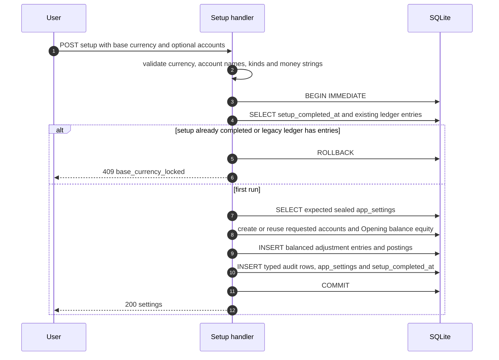

## 3.2 `GET /api/meta`

```json
{ "settings": { "base_currency":"IDR", "timezone":"UTC", "password_must_change":false,
                "extraction_enabled":false, "ai_assistance":false },
  "accounts": [{ "ref":"00000000000000000000000000000003", "name":"BCA Tahapan",
                "kind":"asset", "currency":"IDR", "base_amount_minor":"9540000",
                "archived":false }],
  "payees": [{ "ref":"0000000000000000000000000000000c", "name":"Kopi Kenangan",
              "default_account_ref":"00000000000000000000000000000003",
              "archived":false, "created_at":"2026-02-14T08:00:00Z" }],
  "recurring": [{ "ref":"00000000000000000000000000000004",
                 "payee_ref":"0000000000000000000000000000000c",
                 "account_ref":"00000000000000000000000000000003",
                 "amount_minor":"25000", "currency":"IDR", "cadence":"monthly",
                 "interval_n":1, "business_day_shift":"none",
                 "next_due_on":"2026-03-02", "origin":"user", "state":"active",
                 "created_at":"2026-02-14T08:00:00Z" }],
  "currencies": [{ "code":"IDR", "minor_units":0, "symbol":"Rp" }] }
```

The settings block is shared with `GET /api/settings`, so the first-boot
`password_must_change` flag arrives with the shell. Every account, payee and recurring
rule is returned by following repository cursors internally; the list routes' 200-row
page cap does not truncate this payload. Empty collections are `[]`, and every entity
identifier is a 32-character lowercase hex ref.

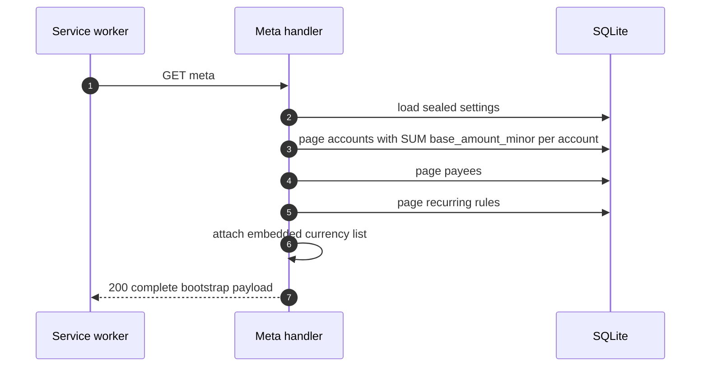

## 3.3 `PATCH /api/settings`

No field is accepted yet. The base currency is chosen once by `POST /api/setup`; the
completion marker locks it even when the ledger is empty, and a legacy database with
entries is also locked (`409 base_currency_locked` on setup). The timezone is pinned at
boot from `APP_TIMEZONE`. Because the decoder refuses unknown fields, sending
`{"base_currency": "USD"}` here answers `400 invalid_json`; `{}` answers `422 empty_patch`.

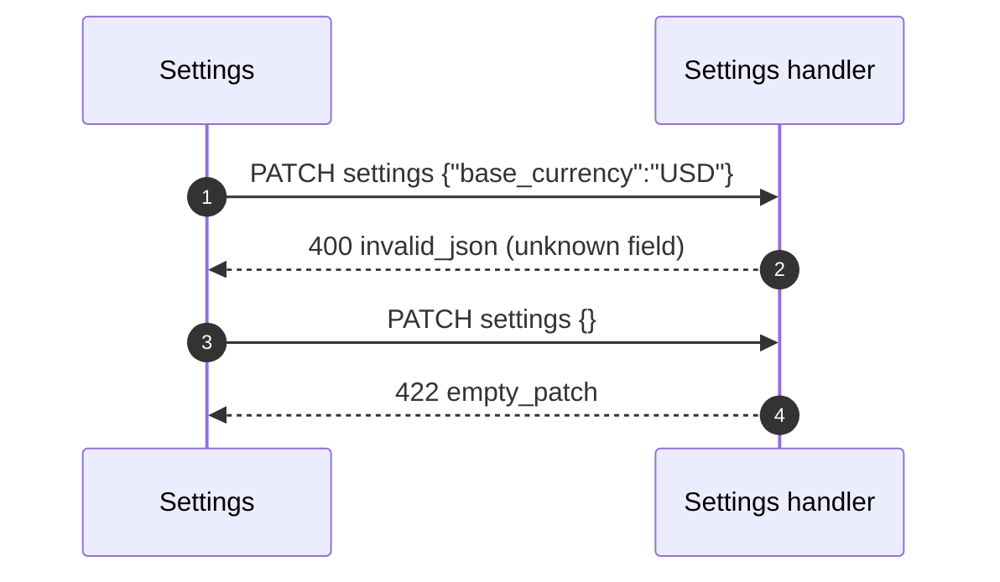

## 3.4 `POST /api/accounts`

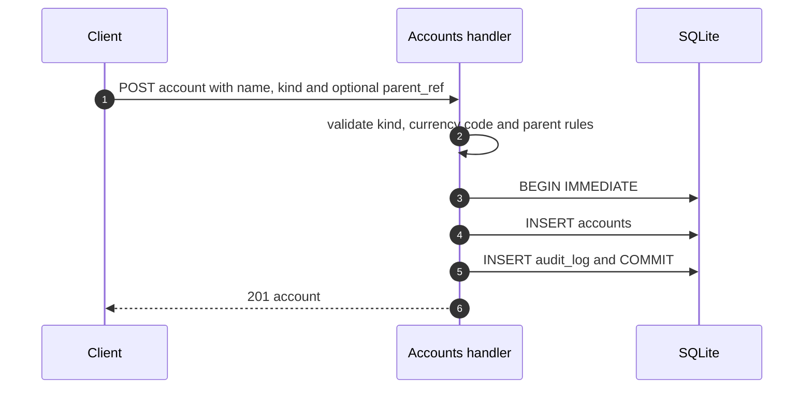

Opening balances are written only by `POST /api/setup`; account creation never posts
to the ledger.

## 3.5 `PATCH /api/accounts/{ref}`

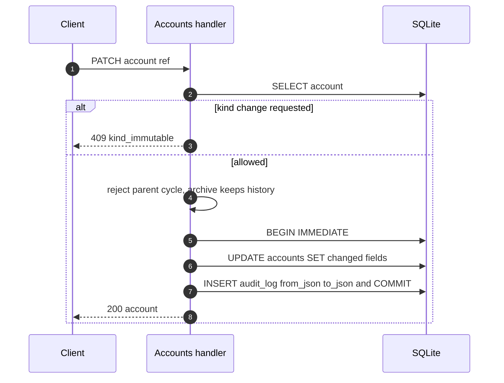

## 3.6 `POST /api/payees`

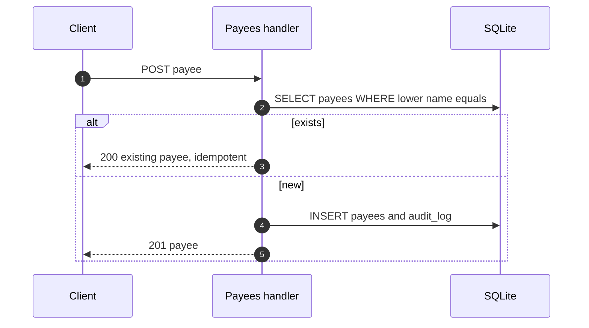

## 3.7 `PATCH /api/payees/{ref}`


## 3.8 `GET /api/entries`

`?from&to&account_ref&payee_ref&source&currency&query&refs&voided&amount_min&amount_max&cursor&with_balance&limit`

The ref filters and `source` take comma-separated unions (`payee_ref=a,b` is either payee),
`query` matches the note or the payee name, and `amount_min`/`amount_max` match any
posting's `ABS(base_amount_minor)` in the base currency. `with_balance=true` with exactly
one `account_ref` adds `running_balance_minor`, the balance of that account after each row
(one windowed `SUM(base_amount_minor)` query per page); without one account there is no
single balance to walk and the field is omitted.
[`endpoints/GET_api_entries.md`](./endpoints/GET_api_entries.md) is the current contract.

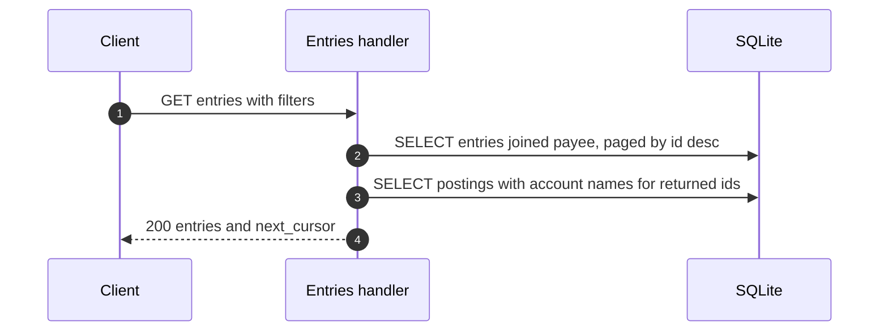

## 3.9 `POST /api/entries`

```json
{ "client_id":"01924f7c-8f3a-7c11-9d0e-2b7f5a1c9e42",
  "occurred_on":"2025-09-14",
  "payee_ref":"0000000000000000000000000000000c", "note":"flat white",
  "currency":"IDR",
  "postings":[{ "account_ref":"00000000000000000000000000000015", "amount_minor":"25000" },
              { "account_ref":"00000000000000000000000000000003", "amount_minor":"-25000" }] }
```

Note the date: three months back. Any month is writable, because the ledger is the only truth.

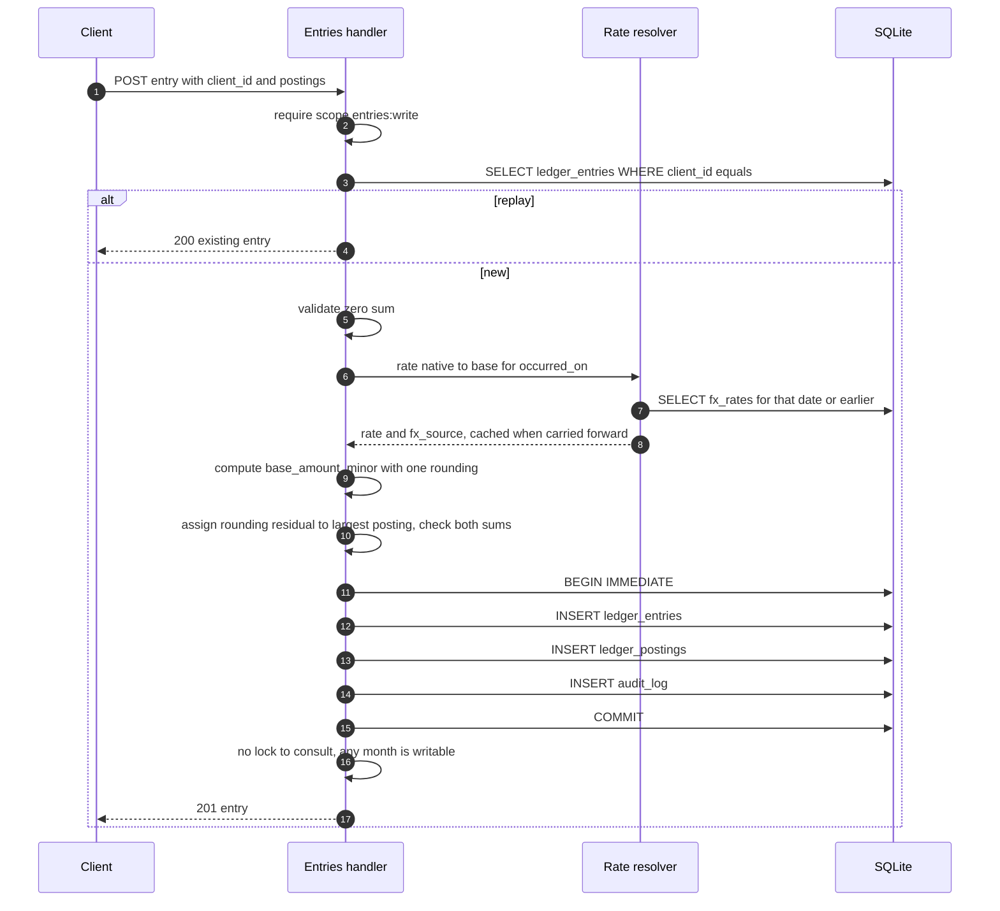

## 3.10 `PATCH /api/entries/{ref}`

```json
{ "note":"flat white, large", "payee_ref":"0000000000000000000000000000000d" }
{ "void": true, "reason": "duplicate of 811" }
```

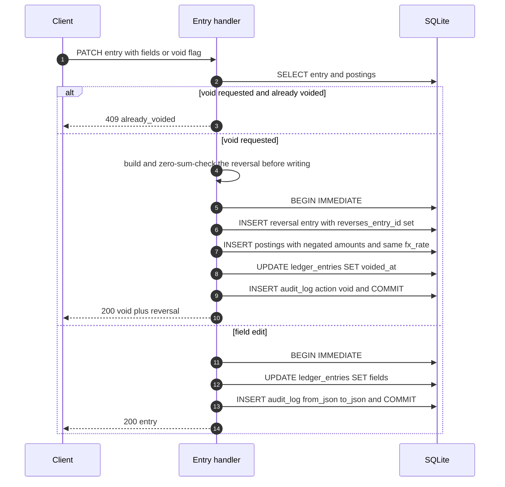

## 3.11 `GET /api/captures`

`?status=&refs=&cursor=&limit=`. Extracting first, then oldest pending. `batch_id` is a
`POST` body field, not a list filter.

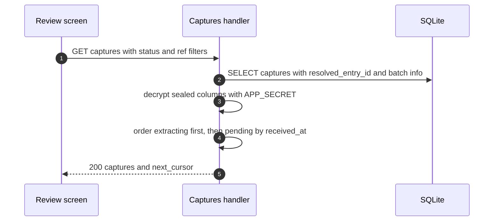

## 3.12 `POST /api/captures`

```json
{ "client_id":"01924f7c-...", "kind":"share",
  "raw_text":"BCA: Transaksi Rp25.000 di KOPI KENANGAN 14/02 08:12" }
```

`multipart/form-data` with `file` for images and statements. A new capture answers `202`;
a replayed `client_id` or the same `dedupe_key` answers `200` with the existing row. With
extraction disabled the row stays `pending` with an empty draft and you type the fields.

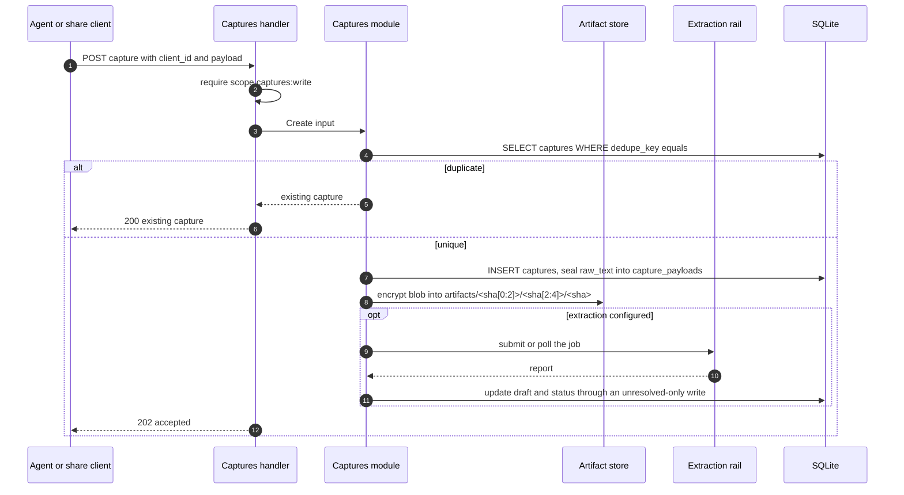

## 3.13 `PATCH /api/captures/{ref}`

```json
{ "action": "approve", "payee_ref":"0000000000000000000000000000000c",
  "occurred_on": "2025-09-14", "currency": "IDR",
  "postings": [{ "account_ref":"00000000000000000000000000000015", "amount_minor": "25000" },
               { "account_ref":"00000000000000000000000000000003", "amount_minor": "-25000" }] }
{ "action": "reject", "reason": "not my card" }
{ "action": "retry" }
{ "action": "match", "entry_ref":"00000000000000000000000000000329" }
```

`extracted` is **not** an accepted action: vendor output reaches a capture through
`retry`; an extraction-provider callback is not shipped. Resolved captures cannot be reopened.

```mermaid
sequenceDiagram
    autonumber
    participant UI as Review screen
    participant API as Capture handler
    participant X as Extraction rail
    participant FX as Rate resolver
    participant DB as SQLite
    UI->>API: PATCH capture with action and fields
    API->>DB: SELECT capture and refuse a resolved one
    alt action retry
        API->>X: poll the stored job_ref
        X-->>API: report
        API->>DB: update draft and status through an unresolved-only write
        API-->>UI: 200 capture
    else action reject
        API->>DB: UPDATE captures SET status rejected, resolution_note sealed, resolved_at
        API->>DB: INSERT audit_log action reject
        API-->>UI: 200 capture
    else action match
        API->>DB: UPDATE captures SET status duplicate, resolved_entry_id
        API-->>UI: 200 capture
    else action approve
        API->>API: validate zero sum and status; failed/extracting normalize via pending
        API->>FX: resolve rate for occurred_on
        FX-->>API: rate and fx_source
        API->>DB: BEGIN IMMEDIATE
        API->>DB: INSERT ledger_entries with source from capture kind
        API->>DB: INSERT ledger_postings
        API->>DB: UPDATE captures SET status approved, resolved_entry_id, resolved_at
        API->>DB: INSERT audit_log action approve and COMMIT
        API-->>UI: 201 entry, capture resolved
    end
```

## 3.14 `POST /api/recurring`

Create a rule directly. There is no `from_entry_id` promotion route and no detection route.

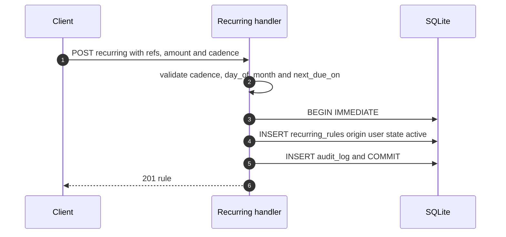

## 3.15 `PATCH /api/recurring/{ref}`

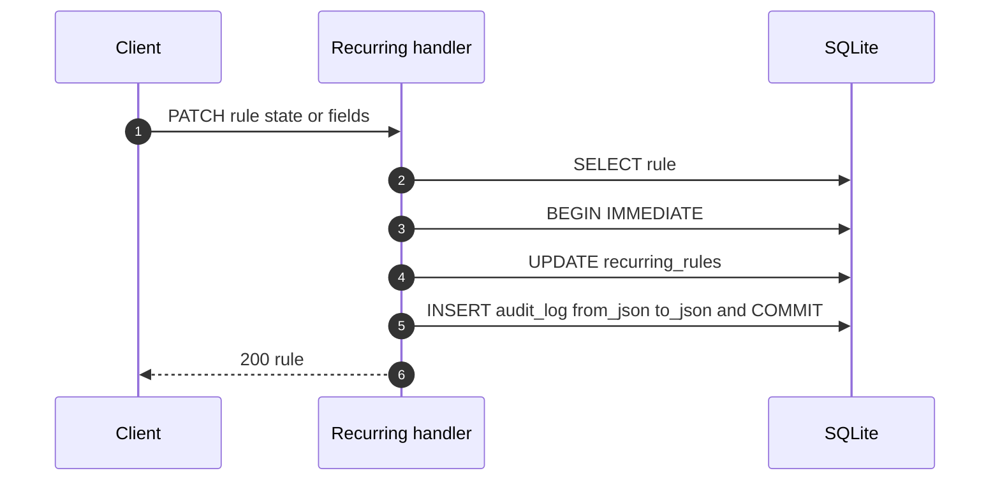

## 3.16 `GET /api/analytics/months`

Derived, never stored: `{ "from":"YYYY-MM-DD", "to":"YYYY-MM-DD",
"months":[{"month":"YYYY-MM","spend_minor":"...","income_minor":"...","net_minor":"..."}] }`.
`from` and `to` are optional; the default is the trailing 12 months ending today in UTC.
There is no statement-balance input, four-way diff or adjustment body: those belong to a
planned month report, not to this route.

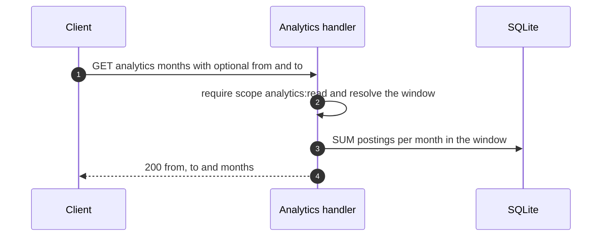

## 3.17 `GET /api/dashboard`

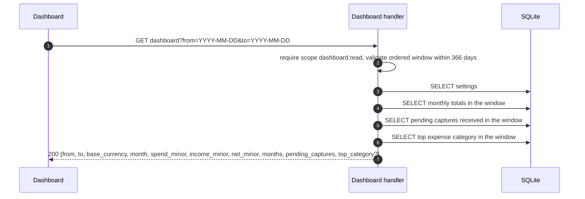

`from` and `to` are required, inclusive, and echoed in the response. The inclusive window
must not span more than 366 days. The month tile describes the newest month with data in
that window; an empty window uses the month of `to`. `months` carries every month in the
window that has data, oldest first. `top_category` is omitted when the window has no
expense category; when present it carries `account_ref`, `account_name` and `amount_minor`.
There is no server-side default and no safe-to-spend, forecast or month-pace field.

## 3.18 `POST /api/tokens`

Root-only. `{ "name":"laptop-agent", "scopes":["captures:write","dashboard:read"],
"expires_at":"2026-12-31T00:00:00Z" }`; `expires_at` is optional. Returns the token row
with `ref`, `name`, `preview`, `scopes`, `created_at`, optional `last_used_at`,
`revoked_at` and `expires_at`, plus `token` once. There is no integer `id` on the wire.

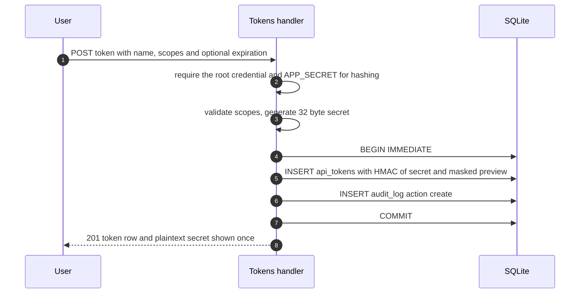

## 3.19 `POST /api/tokens/{ref}/revoke`

Root-only. Revocation stamps `revoked_at`; the row and its journal entries remain and the
credential stops authenticating. The `200` response is the token row, never the secret.


## 3.20 `GET /healthz`

Public.
`200 {"status":"ok","version":"v0.1.1+e0d15ce","started_at":"2026-04-15T08:00:00Z","schema_version":1,"app_secret":"<fingerprint>","base_currency":"IDR","timezone":"UTC","worker_last_run_at":"2026-04-15T09:00:00Z"}`

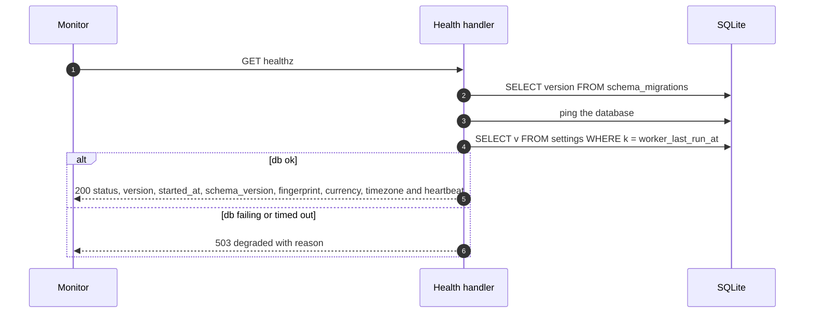

`app_secret` is the sealer fingerprint, never the secret or a sealed envelope. An empty
`worker_last_run_at` means the worker has not finished a run.

`config.Start` also appends one `audit_log` row (`entity_kind=system`, `action=start`,
`actor_kind=system`) with the service name, build version, schema version and UTC start
time, so a restarted process's release evidence remains in the database.

---

# 4. Workers

`spenicle worker` runs one `Runner.Run` per tick, in this order:

1. Find due recurring rules (at most 100) and queue a capture for each, with a catch-up
   cap of 60. The worker never posts a ledger entry.
2. Reclaim artifacts of rejected captures older than `ArtifactRetention` and stamp
   `artifacts.deleted_at`.
3. Drop expired import drafts, then open import uploads older than 24 hours.
4. Resume interrupted export jobs, claim up to 5 queued exports, render them and sweep
   stale `running` and expired `ready` jobs.
5. Poll the configured mailbox, queueing captures and never posting a ledger entry.
6. Write `settings.worker_last_run_at` as the heartbeat.

Rate refresh is not a worker job: `config.Start` warms the ECB-backed rate source at boot.
The ECB adapter performs one XML GET and has no HTML fallback. Extraction is performed
inline by `Module.Captures` during capture creation/retry; there is no extraction worker.
Detection of recurring rules, the periodic integrity job and an extraction-provider callback are
not implemented.
