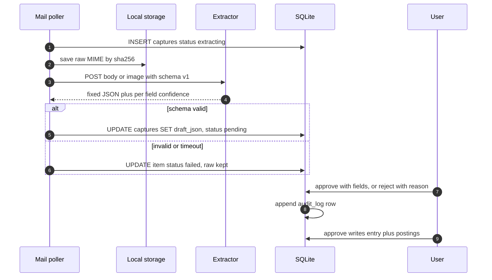
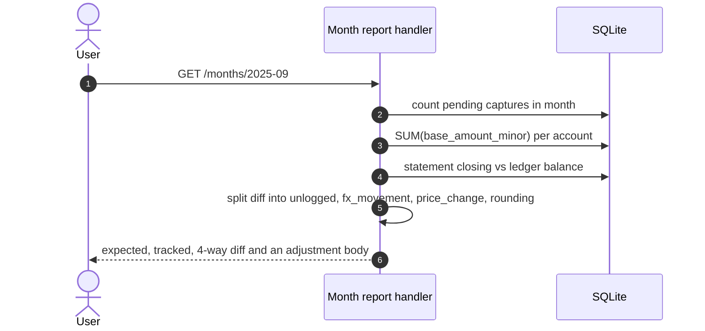

# Spenicle v2 — Design

Status: decisions locked, not yet implemented. Operational docs: [`../README.md`](../README.md).
Schema and API: [`v2-api.md`](./v2-api.md). v1 is frozen on branch `v1`, tag `v1.0.0-locked`.

## Goal

A self-hosted expense tracker that is easy to run and forgives inconsistent logging.

v1 failed on three fronts: three containers to boot, five decisions per entry, and no
place to defer a decision. v2 fixes all three.

## Locked decisions

| decision | value |
| --- | --- |
| storage | SQLite, single binary, no Redis |
| deployment | one `docker run` / one compose file, port 8080 |
| auth | optional password for the browser; scoped API tokens for agents and scripts |
| sealing | `APP_SECRET` is mandatory; it encrypts captures, artifacts and cookies, and the ledger stays readable plaintext |
| capture | PWA share target + offline IndexedDB outbox |
| review | single `captures` queue for every channel |
| ledger | double-entry: `ledger_entries` + `ledger_postings`, zero-sum per entry |
| categories | implemented as `accounts` rows with `kind IN ('expense','income')` |
| base currency | in-app setting (default IDR), locked once the ledger has an entry |
| currencies | embedded ISO 4217 list, not a table |
| FX rates | ECB daily EUR reference rates (XML feed), persisted and cached in memory |
| foreign amounts | a property of the transaction, not of the account |
| extraction | optional: needs a provider API key, otherwise captures stay raw for manual entry |
| recurring | rules generate `captures`; **always** require a tap |
| month close | none: no lock, no snapshot; the month report is derived from the ledger |
| history | fresh start; statement import can backfill via extraction when enabled |
| deletions | none, ever. Void and reject instead; `audit_log` records everything |
| configuration | env vars only, every default in `common/config`, no viper, no config file |
| first boot | adapter seeds the chart of accounts and locks the base currency; no bootstrap module |

## Layout

```
cmd/http/             binary: main.go, bootstrap.go (composition root + wiring)
cmd/http/handlers/    one file per endpoint group; owns the route table
internal/common/httpx/ recovery, tracing, request logging
uat/                  Gherkin suite: uat.go (entry point), steps.go, world.go, features/
internal/common/      utilities with no business logic: config, clock, seal, otel, httpx
internal/constant/    every fixed value shared by more than one package
internal/entity/      shared structs and the invariants that must hold forever
internal/module/      business logic: ledger
internal/repository/  third-party comms: the contracts, plus sqlite and snaptojson
```

Two rules keep it pluggable:

1. Each directory has a root file that presents nothing but its interface —
   `repository.go`, `ledger.go`, `entity.go`, `uat.go`. A caller reads one file to
   learn what the package offers; a second adapter means one new implementation,
   not a new call site.
2. Dependencies point inward: `cmd` → `module` → `entity` + `repository` contracts.
   `entity` imports only the standard library and `constant`, so it can never
   create a cycle.

`cmd/http` is `package main`, so `uat` assembles the same graph by hand from
`repository/sqlite` (open, migrate, `EnsureBaseline`), `module/ledger` and
`handlers.New`. First-boot state lives in the adapter with the migrations, not in a
module: it is initial data, and its rules come from `entity`.

Configuration is one file: `internal/common/config/config.go` holds every environment
variable, **every default** (DB path, HTTP timeouts, shutdown budgets, body cap, pool
sizes, service and tracer names) and the validation; the resolved value is
`entity.AppConfig`. No config file, no viper: seven variables do not need a
precedence chain, and one struct with defaults is testable without a framework.

### Contexts and spans

Every method that crosses a boundary takes `ctx context.Context` as its first
argument and opens one span named after the layer that owns the work:

| Layer | Span name |
|---|---|
| handlers | `Handler.Entries.Post`, `Handler.Health.Check` |
| modules | `Module.Ledger.Post`, `Module.Bootstrap.EnsureBaseline` |
| repositories | `Repository.Sqlite.InsertEntry`, `Repository.Snaptojson.Posting`/`.Polling` |
| common | `Common.Config.Load`, `Common.Seal.Seal` |

Spans start from `internal/common/otel.StartSpan`, which returns the derived
context plus the end function — the span interface never leaks into a caller.

`ServiceName` is the single identity: it is `resource.service.name` *and* the tracer
name, so a span can never be filtered by one name while the service is labelled with
another. `OTEL_EXPORTER_OTLP_ENDPOINT` is OTLP/HTTP; a bare host means HTTPS on port
4318, and `http://` must be written on purpose.
The process has exactly one `context.Background()`: the root in `cmd/http/main.go`
wrapped in `signal.NotifyContext`. Everything below derives from it, including
the shutdown timeout (`context.WithoutCancel`) so the last batch of spans still
flushes. Pure value code (`entity` validation, currency lookup, `clock`) takes no
context and opens no span: there is no boundary to trace.

## Non-goals for v2.0

Multi-user, tags, geo/map, TUI, envelope budgets, cross-currency account transfers,
multi-currency account ledgers, auto-posting recurring rules, bank API integrations.

## Schema (10 tables)

Canonical DDL with every column lives in [`v2-api.md`](./v2-api.md). Summary:

| table | purpose |
| --- | --- |
| `settings` | key/value config |
| `api_tokens` | hashed tokens with scopes, for agents and scripts |
| `fx_rates` | ECB EUR pairs per business day |
| `accounts` | assets, liabilities, and — as `expense`/`income` rows — categories |
| `payees` | counterparties, with capture defaults |
| `recurring_rules` | scheduled expectations, user-confirmed or detected |
| `ledger_entries` | what a human says happened |
| `ledger_postings` | where money moved, zero-sum per entry |
| `captures` | everything unconfirmed, the single review queue |
| — | (no month table: the report is derived from the ledger) |
| `audit_log` | append-only record of every state change |

Rates are exact decimal `TEXT`, money is signed `INTEGER` minor units, enums are `CHECK`
constraints. Currencies are **not** a table: the ISO 4217 list (code, minor units, symbol) is
embedded in the binary and validated at the API boundary.

Optional, only when a query gets slow: `balance_snapshots(account_id, on_date,
base_balance_minor)`, written when you review a month (12 rows/account/year).

## Invariants

1. `SUM(amount_minor) = 0` and `SUM(base_amount_minor) = 0` per `entry_id`.
   Enforced in the write transaction (SQLite cannot defer a cross-row CHECK),
   verified by an integrity job that runs on boot and after imports.
2. Money is always `(integer minor units, ISO code)`. Never float.
3. A posting's base amount is computed once, at write time, and never recomputed.
   This is why a past month's numbers cannot drift when rates change.
4. No `DELETE` on ledger, inbox, or rules. Void, reject, archive.
5. Every state change on those tables appends an `audit_log` row.

## Why postings exist

`ledger_entries` holds what a human says happened. `ledger_postings` holds where money
moved, one row per account touched, summing to zero.

Coffee, Rp 25.000 from BCA:

| entry | payee | occurred_on |
| --- | --- | --- |
| #812 | Kopi Kenangan | 2026-02-14 |

| posting | account | amount_minor |
| --- | --- | --- |
| 1 | Coffee (expense) | +25000 |
| 2 | BCA (asset) | −25000 |

Transfer, split bill, and reimbursement all fit the same shape with no new tables.

## Capture → review → ledger

Every channel lands in `captures`. Nothing touches the ledger until approved.



Lifecycle: `extracting → pending → (approved | rejected | duplicate | failed)`.
Nothing leaves the table. Rejected items keep their reason and can be reopened.

## Extraction contract

Two rails are implemented, and they share one contract
(`internal/repository/extraction`): `Rail()`, `Submit`, `Poll`. A rail owns its vendor's
wire format and answers the unified `extraction.Report` — rail name, status
(`running`/`completed`/`failed`), job ref, JSON data, violations, error. Nothing
upstream knows which vendor produced a draft, and the rail name is stored on the
capture.

| rail | call shape | polling | span |
| --- | --- | --- | --- |
| `snaptojson` | multipart, one partner route | yes (`snap_id`) | `Repository.Snaptojson.Posting` / `.Polling` |
| `openai` | one vision chat completion, JSON answer | no (`ErrNoPolling`) | `Repository.OpenAI.Posting` |

Selection is config: `SNAPTOJSON_API_KEY` wins, `OPENAI_API_KEY` is the fallback,
neither means extraction is off.

### SnapToJSON

The vendor owns the schema and the route. Contract source:
[`snaptojson.com/docs/api`](https://snaptojson.com/docs/api). One route, one verb:

```
POST https://api.snaptojson.com/partner/v1/snaps
Authorization: Bearer <project key>
multipart/form-data: file=<bytes>            submit (≤ 10 MiB, images today)
                     snap_id=<job_ref>       read a snap back
```

| answer | meaning | what we do |
| --- | --- | --- |
| `200` SnapReport | terminal | store the draft, status `pending` (or `failed` on `FAILED`) |
| `202` SnapReport | still running | keep `job_ref`, status `extracting`, read back with `retry` |
| `401/402/404/413/415/422/500/503` ErrorEnvelope | vendor refused | keep the capture, record `code: message` in `extraction_error` |

`SnapReport` is `{job_ref, status: REGISTERED|EXECUTING|COMPLETED|FAILED, result:
{data, valid, violations[]}, error_message}`. `valid: false` is an answer with
violations, not a failure: the review screen shows the fields the reader was unsure
about instead of hiding the capture.

Mapping, in one place (`module/captures`):

| vendor | capture status | stored |
| --- | --- | --- |
| `COMPLETED` | `pending` | sealed `draft_json` = whole `result`, `job_ref` |
| `FAILED` | `failed` | `error_message`, `job_ref` |
| `REGISTERED`, `EXECUTING` | `extracting` | `job_ref` |
| API error | `pending` | `extraction_error` = `code: message` |

A vendor outage never loses the receipt: the capture row is written before the call,
and every failure is recorded on it. With `SNAPTOJSON_API_KEY` unset nothing leaves
the box — the capture lands as `pending` and the fields are typed by hand.

The artifact bytes are handed to the vendor once and not stored; the row keeps
`artifact_hash` (sha256) so a re-share of the same image is the same capture. Sealed
artifact files under `raw/` land with the upload milestone.

### Completeness gate

At ingest, compare the extractor's output against the statement's own header:

1. parsed rows vs `statement_meta.row_count`
2. sum of parsed amounts vs `closing_balance − opening_balance`

Mismatch shows a banner in review instead of failing silently. This is the same
number that later becomes the close diff's "unlogged spend" bucket.

## Recurring

`recurring_rules` never writes to the ledger. It writes a `captures` row:

```
rule.next_due_on <= today
  → INSERT captures(kind='recurring', dedupe_key=sha256(rule_id|due_on),
                   draft_json=<payee, amount, account, category>)
  → rule.next_due_on = next occurrence, last_posted_on = due date
```

Approving it creates the entry with `source='recurring'` and `recurring_rule_id`; the
unique index `(recurring_rule_id, occurred_on)` makes replays idempotent. Rejecting
skips that cycle and leaves a reason.

Because recurring bills enter the same queue, "review all untracked payments" covers
rent and Netflix as well as stray card taps. Expected spend for the month is computed
from the rules due, independent of approval, which is what makes the close diff
meaningful.

Detection writes `origin='detected', state='suggested'` and never posts. Heuristic:
same payee, ≥3 occurrences, amount within ±5%, spacing within ±3 days of the median
interval. Runs weekly.

`business_day_shift` handles a bill due Saturday but paid Monday.

## Month report (derived)

There is no close table and no lock. A month is a range of `occurred_on`; the report is computed
when you look at it.



1. **Read-only.** The report writes nothing. If the unlogged bucket is non-zero it hands back an
   `adjustment_body` you may POST to `/api/entries`; that is your decision, not the system's.
2. **No month is ever locked.** Logging a September expense in November is the normal use case,
   so no request is refused for being "late". There is nothing to reopen either.
3. **Recomputation is cheap.** Four aggregates over `ledger_postings` for one month. That is the
   whole argument against caching it.
4. It stays correct for the same reason the ledger does: `base_amount_minor` is materialized per
   posting, so historical rates never change and a past month's numbers cannot drift.

## Sealing (`APP_SECRET`)

One env var and the sensitive half of the database is encrypted at rest. Not full-disk
encryption — a promise that a stolen `spenicle.db` is not a stolen mailbox.

| sealed | how |
| --- | --- |
| session cookie | HMAC-SHA256; rotating the secret invalidates sessions |
| `captures.raw_text`, `draft_json`, `resolution_note` | AES-256-GCM per row |
| `raw/<sha256>` receipts and statements | AES-256-GCM, key = HKDF(secret, file hash) |
| `api_tokens.token_hash` | HMAC-SHA256 instead of bare sha256 |
| **not** sealed, on purpose | ledger, postings, accounts, amounts |

The ledger stays plaintext so `sqlite3` still answers "what did I spend" when the secret is lost
or the app is broken.

`APP_SECRET` is required: the process does not boot without it, and
`settings.secret_fingerprint` is compared at boot — a mismatch refuses to start rather than
returning garbage. The error names both options.

### Recovery from a changed secret

Sealed columns cannot be decrypted without the key that wrote them, so there is no
re-encryption path and no in-place reset. The process refuses to boot on a
fingerprint mismatch, and there are exactly two honest options:

1. **Restore the original `APP_SECRET`.** Nothing is lost, the boot proceeds.
2. **Start over.** Stop the container, delete `DATA_DIR/spenicle.db` (and `raw/` if it
   exists), boot again: the next boot migrates and seeds a fresh database with the
   current secret. The ledger you keep is the one you backed up.

Neither path touches the design that matters: the ledger is plaintext, so `sqlite3`
still answers "what did I spend" from a backup of the old file.

`entity.AppConfig` keeps no flag for this on purpose. A "reset the secret" switch is
a foot-gun that silently accepts every future mismatch; deleting the file is
explicit, visible in the operator's shell history, and cannot be mistaken for a
routine boot.

## FX

- Worker fetches `https://www.ecb.europa.eu/stats/eurofxref/eurofxref-daily.xml` on boot
  when stale and daily after 16:30 CET. HTML page is fallback only.
- EUR-based only: `rate(A→B) = eurToB / eurToA`.
- No TARGET quote on weekends/holidays → carry the last known rate, labelled `cached`.
- Resolve order: in-memory map → `fx_rates` row for that date → manual prompt.
- Conversion: one expression, one rounding, `big.Rat`, never `float64`:
  `base_minor = round(native_minor × eurToBase / eurToNative × minorRatio)`.

## Offline PWA

1. Precached app shell, hashed assets, versioned service worker. Reading always works.
2. Writes queue in IndexedDB with client-generated UUIDv7 ids; the server upserts on
   that id, so retries never duplicate.
3. Optimistic UI with a pending badge until the server acknowledges.
4. The share target queues locally, so a capture at the till with no signal is not lost.
5. iOS Safari has no share target and no background sync. Fallback: a Shortcut that
   POSTs to the inbox, plus paste-into-inbox.

## Dashboard

No tiles table. Tiles are aggregate queries over postings; a cached tile that disagrees
with the ledger destroys trust faster than a slow query.

1. safe-to-spend: asset balances − recurring due to month end − avg variable × days left
2. 30/60/90 forecast: rules projected on a timeline, at today's rates
3. month pace: tracked vs expected, where expected is computed from the rules due
4. top payees: `GROUP BY payee_id`, this month vs last
5. unreviewed count: `captures WHERE status IN ('pending','extracting')`

## Build order

1. Skeleton: static Go binary, embedded React, SQLite migrations, compose. ~4h
2. Accounts, payees, quick add, postings, zero-sum integrity. ~1.5d
3. FX worker + rate resolver + base materialization. ~0.5d
4. Inbox, review UI, extraction client, schema v1 + completeness gate. ~1.5d
5. Recurring rules + generation into inbox + detection suggestions. ~1d
6. Dashboard tiles + derived month report. ~1d
7. Offline PWA hardening, share target, outbox replay. ~1d

~1.5 weeks of focused work to a usable v2.0.
