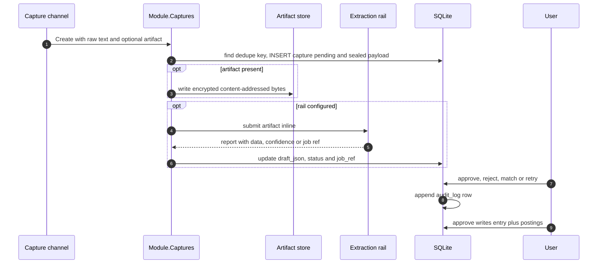

# Spenicle v2 — Design

Status: decisions locked and implemented in the current tree. Items marked planned or
not shipped below are design decisions, not live behaviour. Operational docs: [`../README.md`](../README.md).
Schema and API: [`v2-api.md`](./v2-api.md). v1 is frozen on branch `v1`, tag `v1.0.0-locked`.

## Goal

A self-hosted expense tracker that is easy to run and forgives inconsistent logging.

v1 failed on three fronts: three containers to boot, five decisions per entry, and no
place to defer a decision. v2 fixes all three.

## Locked decisions

| decision | value |
| --- | --- |
| storage | SQLite, single binary, no Redis |
| deployment | one `docker run` / one compose file, port 8080 |
| auth | the instance password is the root bearer credential on every request; scoped API tokens for agents and scripts — no cookie, no browser session |
| sealing | `APP_SECRET` is mandatory; it encrypts captures and artifacts and keys the root credential and the token digests, and the ledger stays readable plaintext |
| capture | one `captures` queue for every channel; PWA share target + offline IndexedDB outbox are planned, not shipped |
| review | single `captures` queue for every channel |
| ledger | double-entry: `ledger_entries` + `ledger_postings`, zero-sum per entry |
| categories | implemented as `accounts` rows with `kind IN ('expense','income')` |
| base currency | in-app setting (default IDR), locked when `POST /api/setup` completes |
| currencies | embedded ISO 4217 list, not a table |
| FX rates | ECB daily EUR reference rates (XML feed), persisted and cached in memory, warmed at boot; scheduled refresh and HTML fallback are planned, not shipped |
| foreign amounts | a property of the transaction, not of the account |
| extraction | optional SnapToJSON rail, called inline; without `SNAPTOJSON_API_KEY` captures stay raw for manual entry. The OpenAI adapter is unwired |
| recurring | rules generate `captures`; **always** require a tap |
| month close | none: no lock and no snapshot; monthly totals are derived from the ledger. The four-way month report is planned, not shipped |
| history | fresh start; statement import commits accepted CSV rows, and extraction is not part of import |
| deletions | no row deletes. Void and reject instead; `audit_log` records state changes. File reclamation is allowed |
| configuration | eight environment variables; every other default lives in `internal/common/config/config.go`, no viper, no config file |
| first boot | adapter seeds `Cash` and `Unsorted`; `POST /api/setup` locks the currency and optional opening balances in one transaction |

## Layout

```
cmd/root.go           cobra root: signal wiring, mounts http, worker and the hidden all
cmd/http/             httpcmd: the API composition root, the route table and the serve loop
cmd/http/handlers/    one file per endpoint group; no route table, no middleware
cmd/worker/           workercmd: the worker composition root and the recurring loop
cmd/worker/handlers/  the recurring loop and the six maintenance jobs it drives
config/runit/         the two runit services the image supervises
internal/common/httpx/ recovery, tracing, request logging
uat/                  Gherkin suite: uat.go (entry point), steps_*.go, world_*.go, snapshot*.go, features/
internal/common/      utilities with no business logic: config, clock, seal, otel, httpx
internal/constant/    every fixed value shared by more than one package
internal/entity/      shared structs and the invariants that must hold forever
internal/module/      business logic: ledger, captures, categorization, connections, exports, exports rendering, imports, intake, rates, settings and tokens
internal/repository/  contracts plus sqlite, ecb, filestore, extraction, mailbox and oauth adapters
```

Two rules keep it pluggable:

1. Each directory has a root file that presents nothing but its interface —
   `repository.go`, `ledger.go`, `entity.go`, `uat.go`. A caller reads one file to
   learn what the package offers; a second adapter means one new implementation,
   not a new call site.
2. Dependencies point inward: `cmd` → `module` → `entity` + `repository` contracts.
   `entity` imports only the standard library and `constant`, so it can never
   create a cycle.

The commands own their wiring, and `uat` assembles the same graph by hand from
`repository/sqlite` (open, migrate, `EnsureBaseline`), `module/ledger`, `httpcmd.New`
(the route table and the middleware chain) and `handlers.New` (the endpoints).
First-boot state lives in the adapter with the migrations, not in a module: it is
initial data, and its rules come from `entity`.

### One-shot setup

`POST /api/setup` is the only route that chooses the base currency. Its optional
`accounts` array carries up to 100 `{name, kind, opening_balance_minor}` objects;
amounts are nonzero minor-unit strings, and `kind` is one of `asset`, `liability`,
`equity`, `expense` or `income`. Each account gets one balanced `adjustment` entry
dated today in `APP_TIMEZONE`, against a dedicated `Opening balance` equity account.
Existing non-archived accounts are matched by `name` + `kind`; the name `Opening
balance` is reserved for that equity account.

The completion marker, sealed settings, accounts, opening entries and their audit
rows commit together under `BEGIN IMMEDIATE`. The transaction refuses a completed
setup, a legacy database that already has entries, or settings changed since the
request was read. Currency-only setup remains valid and still writes the completion
marker, so a second call is `409 base_currency_locked` even with an empty ledger.
Invalid input or a failed write rolls back the whole setup.


### Cold-start payload

`GET /api/meta` is the authenticated shell bootstrap. It returns the same settings
shape as `GET /api/settings` (including `password_must_change`), every account with its
all-time derived base balance, every payee, every recurring rule and the embedded ISO
currency list. Collections are complete: the handler follows repository cursors
internally instead of exposing the normal 200-row page cap, and an empty collection is
`[]`. Accounts, payees and recurring rules are related only by refs; no integer id
leaves the database. Queue counts are deliberately not part of this payload.


Configuration is one file: `internal/common/config/config.go` holds the eight environment
variables, **every other default** (DB path, HTTP timeouts, shutdown budgets, body cap,
pool sizes, service and tracer names) and the validation; the resolved value is
`entity.AppConfig`. No config file, no viper: eight variables do not need a precedence
chain, and one struct with defaults is testable without a framework.

### Contexts and spans

Every method that crosses a boundary takes `ctx context.Context` as its first
argument and opens one span named after the layer that owns the work:

| Layer | Span name |
|---|---|
| handlers | `Handler.Entries.Post`, `Handler.Health.Check` |
| modules | `Module.Ledger.Post`, `Module.Bootstrap.EnsureBaseline` |
| repositories | `Repository.Sqlite.InsertEntry`, `Repository.Snaptojson.Posting`/`.Polling` |
| common | `Common.Config.Load`, `Common.Seal.Seal` |

Spans start from `internal/common/otel.StartSpan`, which returns the derived
context plus the end function — the span interface never leaks into a caller.

`ServiceName` is the single identity: it is `resource.service.name` *and* the tracer
name, so a span can never be filtered by one name while the service is labelled with
another. `OTEL_EXPORTER_OTLP_ENDPOINT` is OTLP/HTTP; a bare host means HTTPS on port
4318, and `http://` must be written on purpose.
Each process has exactly one `context.Background()`: the root in `cmd/root.go`
wrapped in `signal.NotifyContext`. Everything below derives from it, including
the shutdown timeout (`context.WithoutCancel`) so the last batch of spans still
flushes. Pure value code (`entity` validation, currency lookup, `clock`) takes no
context and opens no span: there is no boundary to trace.

## Non-goals for v2.0

Multi-user, tags, geo/map, TUI, envelope budgets, cross-currency account transfers,
multi-currency account ledgers, auto-posting recurring rules, bank API integrations.

## Schema (25 domain tables plus `schema_migrations`)

Canonical DDL with every column lives in [`v2-api.md`](./v2-api.md). Summary:

| table | purpose |
| --- | --- |
| `settings` | sealed app settings and key/value worker stamps |
| `api_tokens` | hashed tokens with scopes, for agents and scripts |
| `fx_rates` | ECB EUR pairs per business day |
| `accounts` | assets, liabilities, and — as `expense`/`income` rows — categories |
| `payees` | counterparties, with capture defaults |
| `categorization_rules` | deterministic payee → category rules |
| `recurring_rules` | scheduled expectations; no detection path is shipped |
| `ledger_entries` | what a human says happened |
| `ledger_postings` | where money moved, zero-sum per entry |
| `balance_state` | dirty flag for balance rebuilds |
| `running_balances` | derived per-account checkpoints |
| `captures` | everything unconfirmed, the single review queue |
| `capture_payloads` | sealed raw text and draft JSON, one per capture |
| `artifacts` | metadata for content-addressed files under `./data/artifacts` |
| `import_batches` | statement import drafts and terminal batches |
| `import_rows` | parsed or edited rows of a batch |
| `import_events` | append-only import lifecycle |
| `import_uploads` | chunked upload state |
| `import_upload_chunks` | idempotent chunk records |
| `exports` | queued export jobs and their artifacts |
| `export_events` | append-only export lifecycle |
| `custom_queries` | saved analytics queries |
| `audit_log` | append-only record of every state change |
| `connections` | one sealed credential per provider, shared by every service that needs it |
| `mail_messages` | the reference a mailbox poll leaves behind: handle, revision, outcome |

`schema_migrations` is managed by the Go migrator and is not a domain table. There is no
month table: monthly totals are derived from `ledger_postings`.

Rates are exact decimal `TEXT`, money is signed `INTEGER` minor units, enums are `CHECK`
constraints. Currencies are **not** a table: the ISO 4217 list (code, minor units, symbol) is
embedded in the binary and validated at the API boundary.

Running balances are checkpoints in `running_balances`, one per account and entry, with
`occurred_on` copied from the entry so an ordered index can find the prior checkpoint and
shift later ones inside the entry transaction. `balance_state.dirty` forces a rebuild after
a backdated void or reversal. Listing an account reads one checkpoint per returned entry
instead of recomputing a window over every posting.

## Invariants

1. `SUM(amount_minor) = 0` and `SUM(base_amount_minor) = 0` per `entry_id`.
   `entity.CheckZeroSum` runs before the insert and again inside the write transaction
   (SQLite cannot defer a cross-row CHECK). There is no production integrity job. A
   split-conversion rounding residual is assigned once to the largest absolute posting.
2. Money is always `(integer minor units, ISO code)`. Never float. Conversions and
   reversals use checked `int64` arithmetic; the int64 floor is rejected because it
   cannot be negated.
3. A posting's base amount is computed once, at write time, and never recomputed.
   This is why a past month's numbers cannot drift when rates change.
4. No row `DELETE` on ledger, captures, rules or tokens. Void, reject, archive or revoke.
   Reclaiming artifact, import and export files is allowed.
5. Every state change on an account, payee, rule, entry, capture, setting or token appends
   one `audit_log` row inside the same transaction, naming the actor (see *Audit journal*).

## Why postings exist

`ledger_entries` holds what a human says happened. `ledger_postings` holds where money
moved, one row per account touched, summing to zero.

Coffee, Rp 25.000 from BCA:

| entry | payee | occurred_on |
| --- | --- | --- |
| #812 | Kopi Kenangan | 2026-02-14 |

| posting | account | amount_minor |
| --- | --- | --- |
| 1 | Coffee (expense) | +25000 |
| 2 | BCA (asset) | −25000 |

Transfer, split bill, and reimbursement all fit the same shape with no new tables.

## Capture → review → ledger

Every channel lands in `captures`. Nothing touches the ledger until approved.



Lifecycle: `extracting → pending → (approved | rejected | duplicate | failed)`.
`failed` and `extracting` are normalised back to `pending` on read. Nothing leaves the
table; rejected items keep their reason, but every resolved capture refuses further
actions and cannot be reopened.

## Extraction contract

Two rails are implemented, and they share one contract
(`internal/repository/extraction`): `Rail()`, `Submit`, `Poll`. A rail owns its vendor's
wire format and answers the unified `extraction.Report` — rail name, status
(`running`/`completed`/`failed`), job ref, JSON data, violations, error. Nothing
upstream knows which vendor produced a draft, and the rail name is stored on the
capture.

| rail | call shape | polling | span |
| --- | --- | --- | --- |
| `snaptojson` | multipart, one partner route | yes (`snap_id`) | `Repository.Snaptojson.Posting` / `.Polling` |
| `openai` | one vision chat completion, JSON answer | no (`ErrNoPolling`) | `Repository.OpenAI.Posting` — adapter kept for the chat rail, not wired by `config.SelectRail` today |

Selection is config: `SNAPTOJSON_API_KEY` builds the rail, and without it extraction is off
and every capture stays manual. The OpenAI adapter is **not** a fallback — one vendor reads
email, text and PDF, and the second code path is kept for the chat rail.

### SnapToJSON

The vendor owns the schema and the route. Contract source:
[`snaptojson.com/docs/api`](https://snaptojson.com/docs/api). One route, one verb:

```
POST https://api.snaptojson.com/partner/v1/snaps
Authorization: Bearer <project key>
multipart/form-data: file=<bytes>            submit (≤ 10 MiB, images today)
                     snap_id=<job_ref>       read a snap back
```

| answer | meaning | what we do |
| --- | --- | --- |
| `200` SnapReport | terminal | store the draft, status `pending` (or `failed` on `FAILED`) |
| `202` SnapReport | still running | keep `job_ref`, status `extracting`, read back with `retry` |
| `401/402/404/413/415/422/500/503` ErrorEnvelope | vendor refused | keep the capture, record `code: message` in `extraction_error` |

`SnapReport` is `{job_ref, status: REGISTERED|EXECUTING|COMPLETED|FAILED, result:
{data, valid, violations[]}, error_message}`. `valid: false` is an answer with
violations, not a failure: the review screen shows the fields the reader was unsure
about instead of hiding the capture.

Mapping, in one place (`module/captures`):

| vendor | capture status | stored |
| --- | --- | --- |
| `COMPLETED` | `pending` | sealed `draft_json` = whole `result`, `job_ref` |
| `FAILED` | `failed` | `error_message`, `job_ref` |
| `REGISTERED`, `EXECUTING` | `extracting` | `job_ref` |
| API error | `pending` | `extraction_error` = `code: message` |

A read-back never writes a resolved row: `retry` refuses resolved captures before
polling and writes the report through a conditional update, so an approval that lands
during the vendor call wins.

A vendor outage never loses the receipt: the capture row is written before the call,
and every failure is recorded on it. With `SNAPTOJSON_API_KEY` unset nothing leaves
the box — the capture lands as `pending` and the fields are typed by hand.

The artifact bytes are stored once, before the vendor is called: content addressed under
`./data/artifacts/<sha[0:2]>/<sha[2:4]>/<sha256>`, gzipped when the content type is
compressible, encrypted with AES-256-GCM under an HKDF key derived from `APP_SECRET` and
the sha as the additional authenticated data. The row keeps `artifact_hash` (sha256) so a
re-share of the same image is the same capture, and the same bytes uploaded twice are one
file. `GET /api/captures/{ref}/artifact` streams the plaintext back; the worker reclaims
the file of a `rejected` capture once it outlives the retention (`720h`), which is what
turns that route into `410 gone`.

### Completeness gate (planned, not shipped)

There is no `statement_meta` table and no ingest comparison in the current code. Statement
upload parses CSV rows, records deterministic clashes and writes a draft; review commits
accepted rows. The proposed check would compare parsed rows with `statement_meta.row_count`
and the sum of parsed amounts with `closing_balance − opening_balance`, showing a banner
instead of failing silently. Neither the banner nor a close-diff "unlogged spend" bucket
exists today.

## Recurring

`recurring_rules` never writes to the ledger, and neither does the worker: a due rule
queues a `captures` row and waits for a tap.

```
rule.next_due_on <= today
  → INSERT captures(kind='recurring',
                    dedupe_key=sha256(strings.Join(["recurring", rule_ref, due_on], "\x00")),
                    draft_json=<payee, account, category, amount, currency, due_on>,
                    status='pending')
  → rule.next_due_on = next occurrence, last_posted_on = due date
```

`dedupe_key` is the cross-run idempotency: the same occurrence queued twice is one row,
however often the worker ticks. Approving the capture posts the entry with
`source='recurring'` and `recurring_rule_id` resolved from the draft, so the unique index
`(recurring_rule_id, occurred_on)` still refuses a double post; rejecting it skips that
cycle and leaves a reason. The worker still receives the ledger — `cmd/worker/handler.go`
passes it into the captures module for intake and into the export renderer's deps — but it
posts no entry on its own: `captures.Queue` is its half of the module, which is what makes
the rule mechanical instead of a promise.

Because recurring bills enter the same queue, "review all untracked payments" covers
rent and Netflix as well as stray card taps. Expected spend for the month, independent of
approval, is **planned, not shipped**. Detection is also **planned, not shipped**: there is
no `origin='detected'` path and no detection worker. Rules are created directly through
`POST /api/recurring`; `PATCH /api/recurring/{ref}` appends an `update` audit row.

`business_day_shift` handles a bill due Saturday but paid Monday.

## Month report (derived)

There is no close table and no lock. The shipped report is `GET /api/analytics/months`:
an optional inclusive `from`/`to` window (default: trailing 12 months ending today in UTC)
and `{from,to,months:[{month,spend_minor,income_minor,net_minor}]}`. `GET /api/dashboard`
adds the base currency, newest month with data, pending capture count and top expense
category for a required 366-day-or-shorter window.

No month is ever locked: logging a September expense in November is normal, and backdated
writes are allowed. `base_amount_minor` is materialized per posting, so historical rates
do not change past months.

**Planned, not shipped:** a derived four-way month report with `expected`, `tracked`,
`unlogged`, `fx_movement`, `price_change`, `rounding`, statement-balance input and an
`adjustment_body` you could POST to `/api/entries`. There is no `GET /months/{year_month}`
route and no close-diff calculation today.

## Sealing (`APP_SECRET`)

One env var and the sensitive half of the database is encrypted at rest. Not full-disk
encryption — a promise that a stolen `spenicle.db` is not a stolen mailbox.

| sealed | how |
| --- | --- |
| the root credential | HMAC-SHA256 over the password hash; changing the password invalidates it |
| `capture_payloads.raw_text`, `capture_payloads.draft_json`, `captures.resolution_note` | AES-256-GCM per row |
| `./data/artifacts`, `./data/exports` and `./data/imports` files | AES-256-GCM under the artifact HKDF key; plaintext sha is the additional authenticated data |
| `api_tokens.token_hash` | HMAC-SHA256 instead of bare sha256 |
| **not** sealed, on purpose | ledger, postings, accounts, amounts |

The ledger stays plaintext so `sqlite3` still answers "what did I spend" when the secret is lost
or the app is broken.

`APP_SECRET` is required: the process does not boot without it, and
`settings.secret_fingerprint` is compared at boot — a mismatch refuses to start rather than
returning garbage. The error names both options.

### Recovery from a changed secret

Sealed columns cannot be decrypted without the key that wrote them, so there is no
re-encryption path and no in-place reset. The process refuses to boot on a
fingerprint mismatch, and there are exactly two honest options:

1. **Restore the original `APP_SECRET`.** Nothing is lost, the boot proceeds.
2. **Start over.** Stop the container, delete `./data/spenicle.db` and the old
   `artifacts`, `exports` and `imports` directories under `./data`, then boot again:
   the next boot migrates and seeds a fresh database with the current secret. The
   ledger you keep is the one you backed up.

Neither path touches the design that matters: the ledger is plaintext, so `sqlite3`
still answers "what did I spend" from a backup of the old file.

`entity.AppConfig` keeps no flag for this on purpose. A "reset the secret" switch is
a foot-gun that silently accepts every future mismatch; deleting the file is
explicit, visible in the operator's shell history, and cannot be mistaken for a
routine boot.

## Audit journal

`audit_log` is a journal, not a trigger table: one append-only row per state change,
written inside the same transaction as the change, so a rolled-back write leaves nothing
behind and a committed one cannot be forgotten.

| column | what it answers |
| --- | --- |
| `entity_kind` | which table, as a bounded name: `account`, `payee`, `recurring_rule`, `ledger_entry`, `capture`, `categorization_rule`, `setting`, `api_token`, `system` |
| `entity_id` / `entity_ref` | the row, by integer for joins and by ref for filtering without one |
| `action` | `create`, `update`, `void`, `approve`, `reject`, `advance`, `revoke`, `generate`, `retry`, `start` |
| `actor_kind` / `actor_ref` | `user`, `worker`, `system` — and, for a token, its ref in `actor_ref` (the kind stays `user`) |
| `from_json` / `to_json` | what the change touched, as typed payload structs (`entity.EntryCreated`, …) validated with the same tags the API uses |
| `at` | when, UTC |

The actor is not a parameter on every repository method: it rides the context
(`internal/common/actor`), set once at each boundary — the HTTP identity middleware, which
puts a token's ref in `actor_ref`, the worker run, and the system default for anything with
no actor. The journal is read through `GET /api/audit`, filtered by kind,
ref, action, actor and a day range.

What is deliberately **not** journaled twice:

- imports and exports keep their own append-only `import_events`/`export_events`, which
  are also the API's own resource; the batch or job lifecycle is the journal for them.
- `artifacts` rows are metadata of a capture, and the capture's own row already says what
  was received; the metadata is not a second event.
- `settings` rows are journaled by **key only**, never by value: one of those values is the
  sealed password envelope, and the journal is not a second copy of it. The worker
  heartbeat (`worker_last_run_at`) is a metric, so it writes none at all; its stamp means
  a whole run finished.
- process boots are journaled once as `system`/`start` with the service, build version,
  schema version and UTC start time, which is the durable recovery/release evidence.
- an API token's `last_used_at` is a usage stamp, not a state change.

## FX

- `config.Start` warms the rate source at boot through `ecb.New` and `rates.New`.
  There is no daily rate worker job. The ECB adapter performs one XML GET; the HTML
  fallback is planned, not shipped.
- EUR-based only: `rate(A→B) = eurToB / eurToA`.
- No TARGET quote on weekends/holidays → a stored earlier rate is labelled `cached`.
- Resolve order: in-memory map → `fx_rates` row on or before that date → not found.
  There is no manual prompt.
- Conversion: one expression, one rounding, `big.Rat`, never `float64`:
  `base_minor = round(native_minor × eurToBase / eurToNative × minorRatio)`.

## Offline PWA (planned, not shipped)

No frontend assets, service worker, IndexedDB outbox or share target exist in this repo.
The proposed design is a precached app shell with hashed assets and a versioned service
worker, writes queued in IndexedDB with client-generated UUIDv7 ids, an optimistic pending
badge, a local share-target queue, and a Shortcut/paste fallback for iOS Safari.
Today captures arrive only through the API and the worker's mailbox poll.

## Dashboard

No tiles table. `GET /api/dashboard` requires `from` and `to` (ordered, at most 366 days)
and returns `{from,to,base_currency,month,spend_minor,income_minor,net_minor,months,
pending_captures,top_category?}`. `top_category` carries `account_ref`, `account_name`
and `amount_minor` when the window has an expense category.

**Planned, not shipped:** safe-to-spend, 30/60/90 forecast, month pace and top-payee
tiles. They are not fields on the live response.

## Build order (historical)

1. Skeleton: static Go binary, embedded React, SQLite migrations, compose. ~4h
2. Accounts, payees, quick add, postings, zero-sum integrity. ~1.5d
3. Rate resolver + base materialization (boot warming, not an FX worker). ~0.5d
4. Inbox, review UI, extraction client, schema v1. ~1.5d
5. Recurring rules and generation into captures (no detection). ~1d
6. Dashboard aggregates + derived monthly totals. ~1d
7. Offline PWA hardening, share target, outbox replay. **Not shipped.**

The completeness gate, detection suggestions and the derived four-way month report from
the original plan are also not shipped.

## Email intake and provider connections

Live in the current tree, and not a bank API integration (still a non-goal). It reads a
Gmail mailbox the user controls and turns a message into a capture.

1. **Intake is a transport, not a pipeline.** A poll produces a `captures` row through
   `Module.Captures.Create`; approval still posts the ledger, so nothing here can write an
   entry.
2. **Both processes can poll.** The worker runs `Module.Intake.Poll` on each tick, and
   `POST /api/intake/run` calls the same path on demand; both use the stored connection
   and are capped per run.
3. **Gmail is the shipped adapter.** `internal/repository/mailbox/gmail` is the only
   mailbox implementation; a generic IMAP adapter remains planned. A shared Google OAuth
   connector owns the wire format and credentials.
4. **Credentials belong to a connection, not to intake.** `connections` holds one row per
   provider (`UNIQUE (provider)`), tokens sealed with `APP_SECRET`, scopes kept as a union —
   so Calendar later re-authorises the same row instead of minting a second credential.
5. **A reference per message, and no content.** `mail_messages` records the re-fetch handle,
   the provider revision and when it was seen; never a subject, a sender or a body. Content
   stays sealed in the capture, exactly like an artifact.
6. **Refresh creates a new reference when the provider revision changes.** Re-reading a
   message can answer `unchanged`, or mark the old row `superseded_by` and link a new
   capture. No ledger mutation, no row delete.
7. **The stored connection is shared.** The API and worker both read the stored access
   token through the same connector; re-authorisation replaces that row's sealed grant.
8. **Personal Gmail is the awkward case.** The consent screen must be in `In production`
   (unverified) or refresh tokens expire weekly; `invalid_grant` is persisted as
   `status = reauth_required` so the UI asks for one re-authorisation instead of retrying
   forever.

Live routes: `GET/PATCH /api/intake`, `POST /api/intake/run`,
`GET /api/intake/messages`, `GET /api/intake/messages/{ref}` and
`POST /api/intake/messages/{ref}/refresh` are root-only; the root-only connections
surface is `GET /api/connections`, `POST /api/connections/google` and
`POST /api/connections/{ref}/revoke`. `GET /api/connections/google/callback` is the
public provider redirect. The earlier `POST /api/connections/google/callback` route was
superseded by `GET`.
